

  

<h1 align="center">kibbl.</h1>

  <em>A bridge between hardware, software and AI, for a home that knows about itself, its people and its costs.</em>

  <a href="https://kibbl.uk"><b>kibbl.uk</b></a> · self-hosted on a home server, behind Cloudflare

  
  
  
  
  
  

> This repository is a showcase: what kibbl. does, how it is built and what it looks like. The source code (firmware, server, app and CAD) is in a private repository.

  

---

## Why I built it

The appliances in my home were outdated, missing features or not working at all. Each one that did work had its own app and its own cloud, and none of them knew about the others. I wanted **one system that knows about my home, my health and my expenses**, and that lets *me* decide what happens with that data.

So I:

* **reverse engineered, soldered and reflashed** devices that were locked to a vendor (a CO₂ traffic light, a Wi-Fi LED controller behind the TV, cameras) with my own firmware,
* **attached the APIs** of the devices I don't build myself, such as **tado** (heating) and **PetKit** (cat feeder), so they are controlled from the same place,
* **uploaded my landlord's heating statement** (the *Nachzahlung*). kibbl. reads it with OCR and tracks my heat use over the year against what I pay in advance,
* read my **electricity meter**, an old Ferraris meter with a spinning disc, with **EMONI**, a local OCR meter reader over **NB-IoT / LoRaWAN** that I developed,
* connected all of it to an **MCP server**, so an AI assistant can read the home and act on it,
* run an **adaptive PID controller** on top of the thermostats that keeps each room comfortable *and* healthy, without heating more than needed,
* linked **Fitbit / Google Health** data (heart rate, HRV, sleep, SpO₂, sedentary time) with my **gym sessions**, which are logged in the app itself.

The whole app is hosted on my own home server and is **open to other users**: anyone can sign up and connect their own Fitbit, gym training, home devices and AI assistant.

### Your data, your decision

Devices record much more than their apps show you. **Google's Fitbit app, for example, does not show the sedentary data the tracker records.** The API has it, so kibbl. stores the full history on my own server and shows it: minutes worn, active and sedentary through the day, next to heart rate per minute and sleep stages. The goal of the project is to give users control over their own data and over what they do with it.

---

## At a glance

| | |
|---|---|
| **Own hardware** | kibbl. cam (live stream, motion activity), kibbl. air (CO₂, climate, open windows, cigarettes, fire warning), kibbl. light (TV backlight), kibbl. feeder (self-designed iris valve), all on one protocol, set up over USB from the browser or from a phone |
| **Integrated vendors** | tado (heating, every room), PetKit (feeder), Google Health / Fitbit, Bambu Lab printer over local MQTT, Open-Meteo weather |
| **Meters** | electricity through EMONI's optical OCR reader (NB-IoT / LoRaWAN), heat from radiator allocators and OCR of the yearly heating statement |
| **Health & training** | full history of the tracker, a gym logger for every kind of training (lifting, runs, rides, Pilates, HIIT…), heart rate during each session, muscle volume per week, Strong import |
| **AI** | an MCP server with 40+ tools: it reads everything, and changes what a person can change in the app, every change logged |
| **Control** | adaptive PID heating per room, light moods and timers, night modes, open window → heating off |
| **Hosting** | Docker Compose on a home server, public at kibbl.uk through a Cloudflare tunnel, OTA firmware updates with rollback |

---

## The app

The pages below come from a demo account with generated data, so none of my personal data is shown.

### Home and activity

The home page shows the cameras, meters and devices together. Motion is logged as **activity, without pictures by default**: each camera has a setting for whether a picture of a movement is kept.

  
  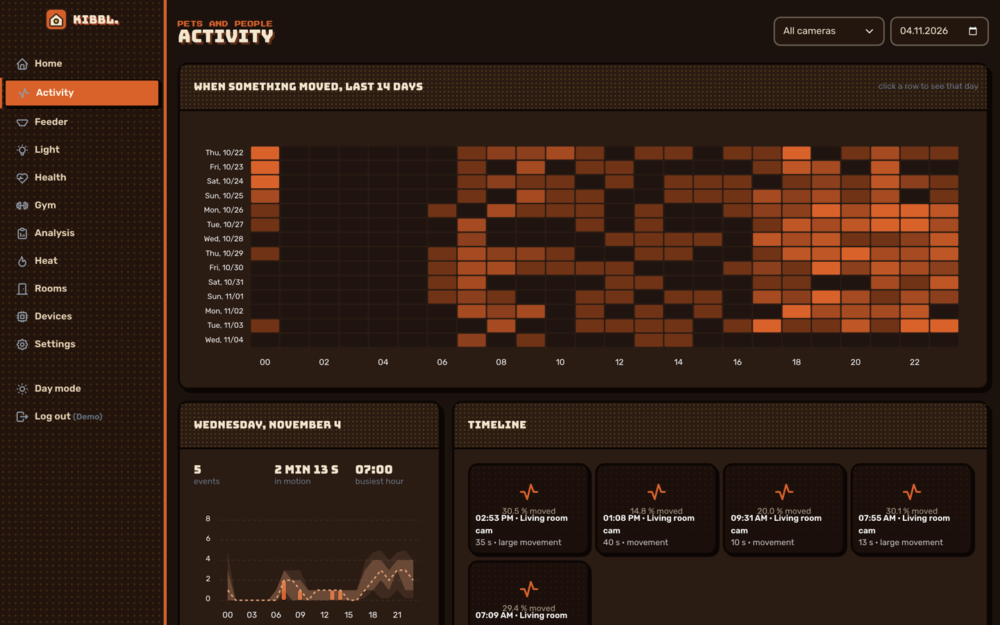

### Air: a reflashed CO₂ traffic light

A CO₂ traffic light board running new firmware I wrote. It measures CO₂, temperature and humidity, detects open windows from the CO₂ falling towards fresh air, counts cigarettes from exhaled-smoke CO₂ puffs, warns of a possible fire and gives health hints (dry air, mould risk at outer walls, stale air in the bedroom).

  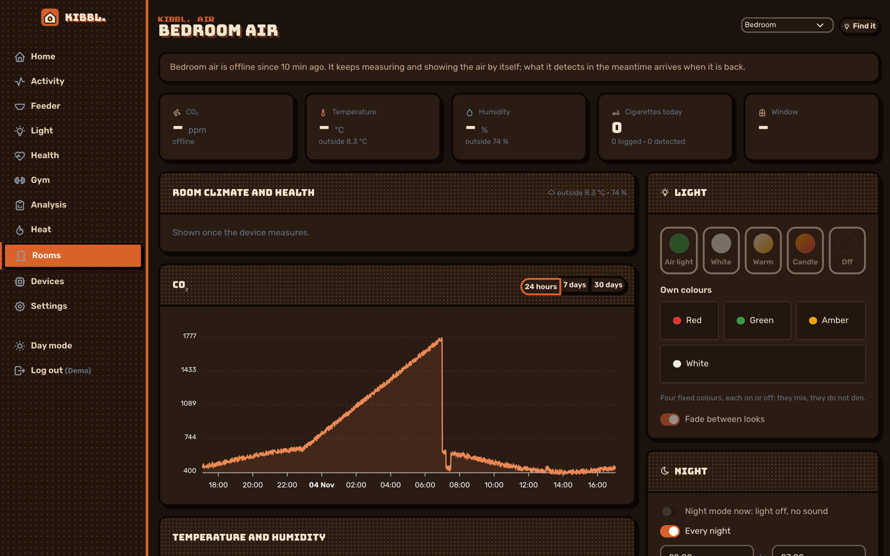

### Electricity: an old Ferraris meter, read by OCR

An **EMONI** reader photographs the meter, reads the digits on the device and sends them over NB-IoT / LoRaWAN. kibbl. keeps every reading and shows consumption by day, month and year, power, battery and the base load at night.

  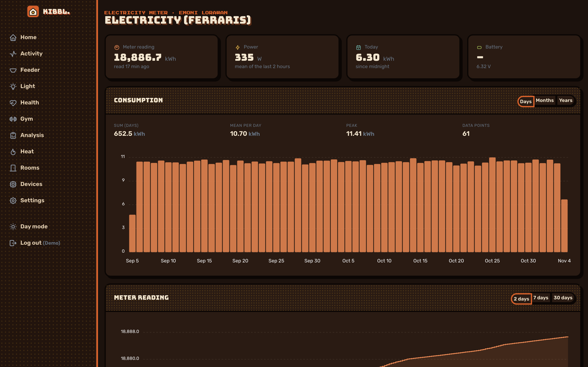

### Heat: from radiators and the landlord's statement

Heat cost allocators on the radiators plus the yearly statement, read by OCR. The use between two readings is spread over the days by tado's heating hours or by degree days, so the costs are known before the bill arrives.

  

### Gym and health

A gym logger built for the phone (installable, works offline): every kind of training, last time's sets next to each set, rest timer, records. It is linked with the tracker, so a session's heart rate sits next to its sets. Progress shows the days trained, minutes by kind and the weekly volume per muscle against the range that builds it.

  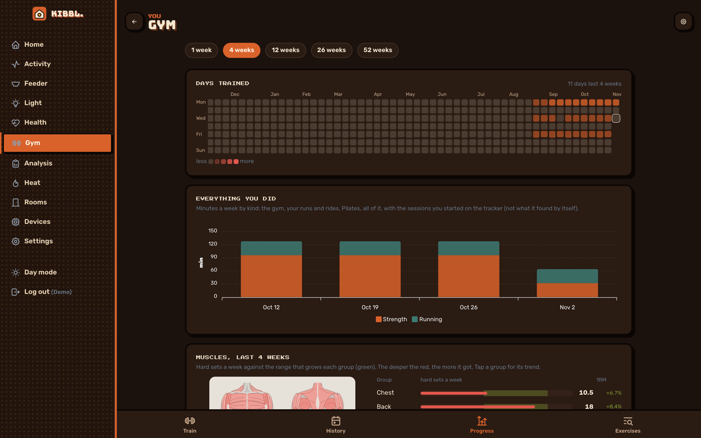
  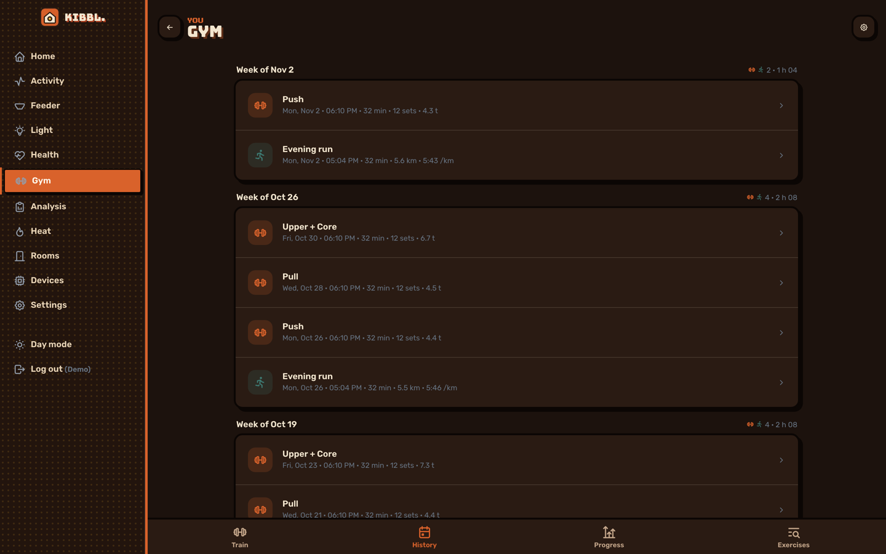

### Light and analysis

The TV backlight is a reflashed Wi-Fi LED controller with moods, effects (sunrise, candle, aurora…), weekly timers and alert flashes. The analysis page collects whatever stands out across the home: base load, offline devices, open windows while heating, battery.

  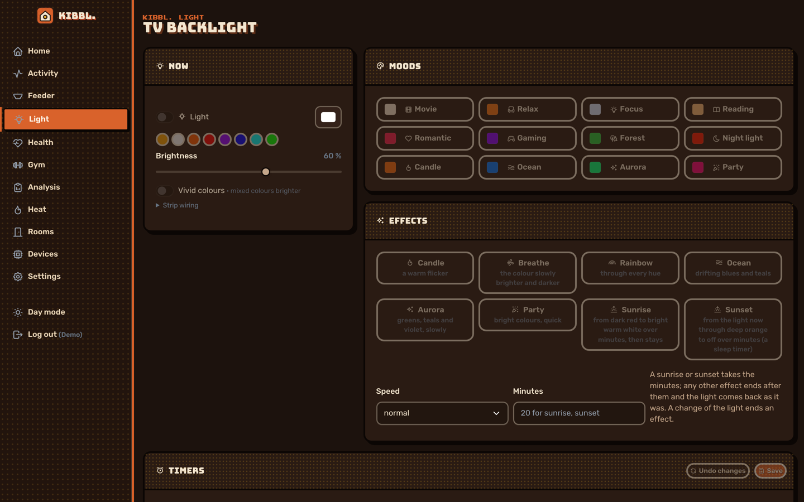
  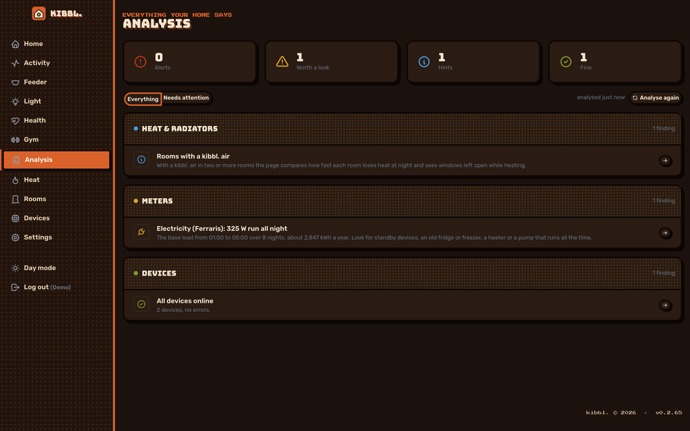

---

## AI over MCP

kibbl. serves an **MCP endpoint** (Streamable HTTP, OAuth sign-in or personal tokens). Any MCP-capable assistant can connect to it and reach **all** of the home's data, then act through the same checks as the app. Every change is logged as made by the assistant.

What that makes possible:

* **Mood, light and temperature:** tell the assistant how you feel and it sets the light mood and the room temperature to match.
* **Mental health and the nervous system:** log how you are doing in a conversation. The assistant reads it together with the body's signals (HRV, resting heart rate, last night's sleep, sedentary time, CO₂ in the room) and decides which settings at home help **calm the nervous system down**: warm, dim light without blue in the evening, a comfortable temperature, fresh air, a reminder to move.
* **Heating:** hold a room by the adaptive PID controller, change the weekly schedule, switch off while a window is open.
* **Questions across everything:** *"Why was my electricity higher last week?"*, *"How did my resting heart rate change since I started training three times a week?"*, *"Is the bedroom air stale at night?"*

Read tools cover devices, a live camera picture, motion events and activity, air, heating and its schedule, meters, heat and costs, health per day and through a day, workouts and training progress, the feeder and the analysis. Write tools cover heating, light (moods, effects, timers, alerts), the kibbl. air, cameras, rooms, the feeding plan and heat readings. Firmware updates, Wi-Fi, restarts, removing devices and deleting data are deliberately **not** available to the assistant.

The full tool list is in **[docs/mcp.md](docs/mcp.md)**.

---

## Adaptive PID heating

The radiator thermostat measures next to the radiator, so the room ends up colder or warmer than asked. kibbl. runs an **outer control loop** over tado's own:

* The room is modelled as a first-order system, `dT/dt = a·(u − T) + b`, and its parameters are re-estimated after each reading by **recursive least squares with forgetting**. The model follows the season, the weather and the radiator.
* The gains come from the room's time constant τ by **IMC tuning**: `Kp = τ / (λ + θ)`, `Ti = τ`, `Td = θ / 2`. A slow room gets a stronger push, a fast room a gentler one.
* Derivative on the measurement (no kick when the setpoint changes), **anti-windup**, the integral held while a window is open.
* Output in tado's 0.5 °C steps with hysteresis, within tado's daily API budget. Every setting expires, so the thermostats fall back to their own schedule if the server stops.

The target is a temperature that is **comfortable and healthy** (WHO guidance, humidity and mould risk at outer walls) without heating more than needed.

---

## Hardware

### The self-designed feeder

I started working on my own cat feeder. It portions the food with a **3D-printed iris valve** driven by a NEMA 17 closed-loop stepper. Every part is a **parametric Python script** (build123d) with STEP and STL committed next to it.

  
  
  

  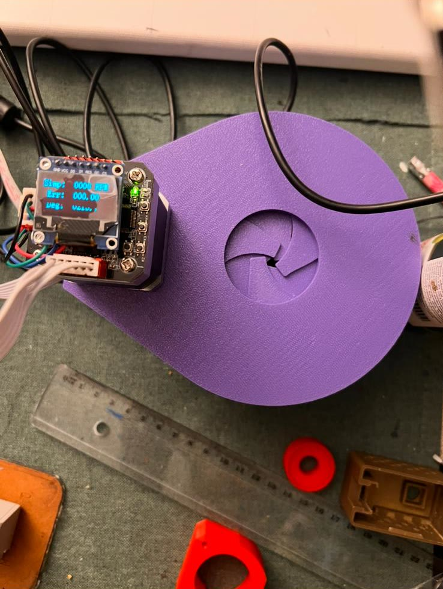
  
  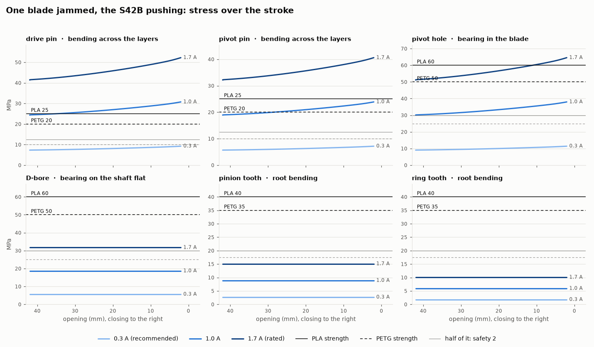

#### Stress test: overnight, with the AI watching

To stress-test the iris, I **pointed a kibbl. cam at the opening** and gave the job to an **AI assistant over MCP**. It watched the opening through the camera, decided how far to open and close the iris, and checked from the picture that the valve did what it was told. **The test ran overnight with no supervision.**

  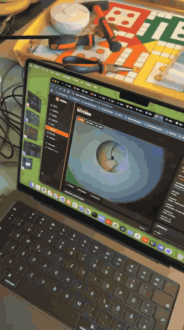

  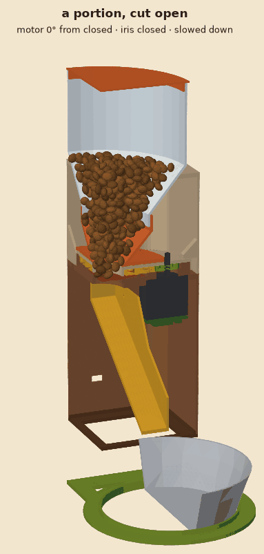
  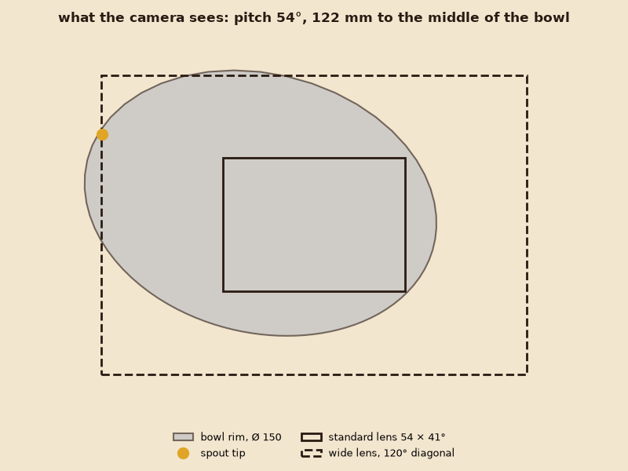

### Camera case

  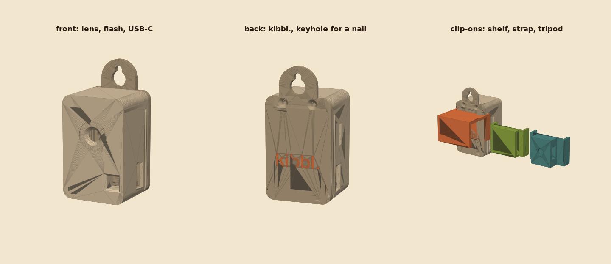

---

## Architecture

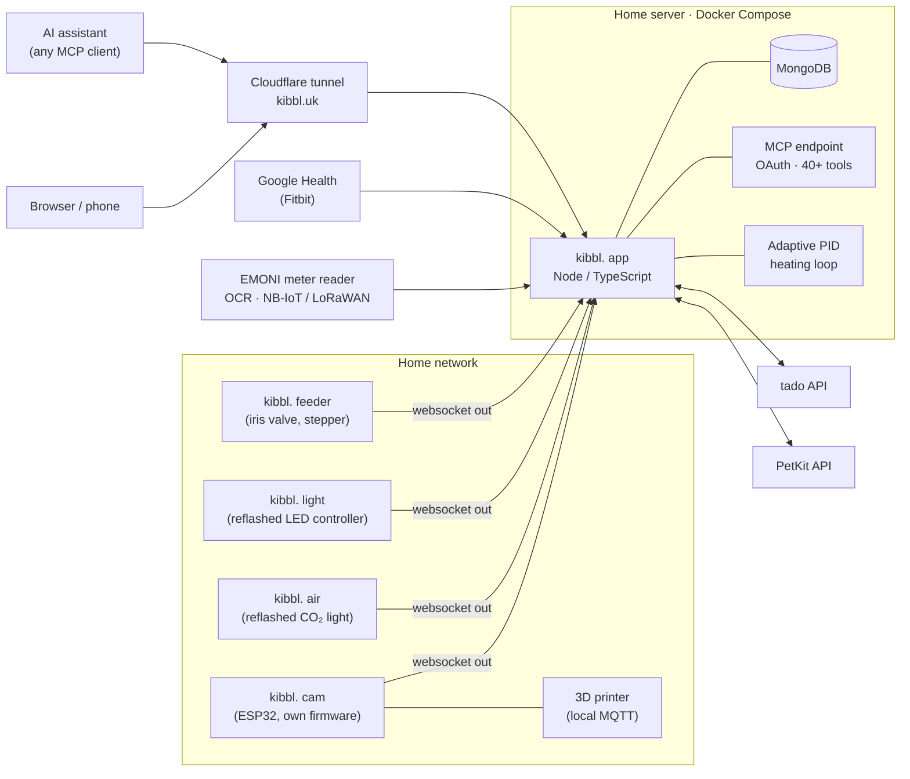

* **Firmware** in C on ESP-IDF, one shared core (server link, commands, Wi-Fi setup portal, OTA with rollback, NVS) and one project per product. The LED controller is an ESP8285 with 1 MB flash, so it is an Arduino sketch that speaks the same protocol and fits two images for OTA.
* **Devices only connect outwards** over one websocket, so nothing at home needs a port forward. Setup works over USB from the browser (Web Serial) or from a phone through the device's own setup Wi-Fi and a pairing code.
* **Server:** Node / TypeScript (Express, socket.io, ws), MongoDB, one process. Vendor tokens are encrypted at rest (AES-256-GCM).
* **App:** a multi-page Vite app in its own autumn, halftone "entering a game" theme, with day and night modes. The gym part is an installable PWA.
* **Hosting:** Docker Compose on my home server, published at **kibbl.uk** through a Cloudflare named tunnel. One-command deploys.

---

## Status

kibbl. runs every day in my home. Next up: the feeder on its own EMONI-based board (camera, illuminator and motor driver on one PCB), telling pets from people on the camera, and the parts for heating control.

---

© Huzaifa Ejaz. Images and videos in this repository may not be reused without permission.

