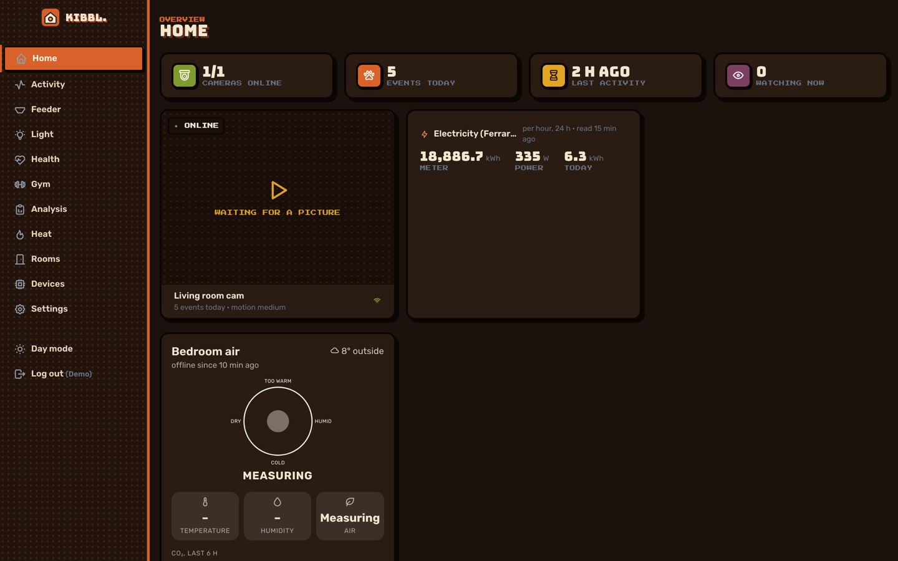
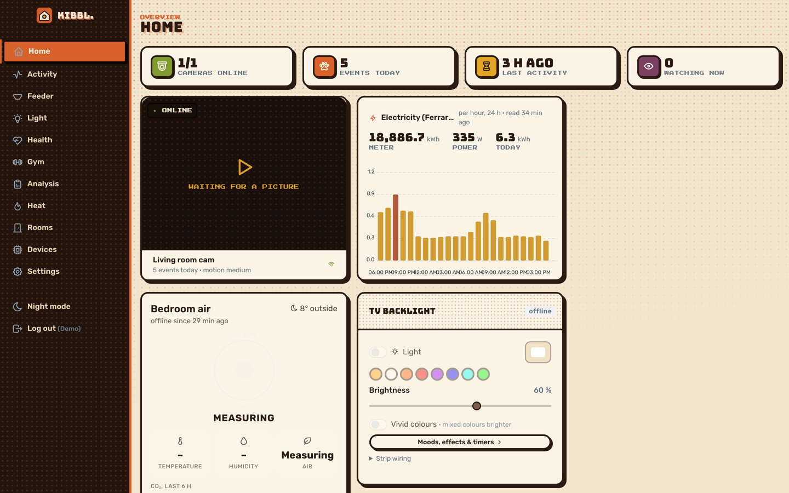
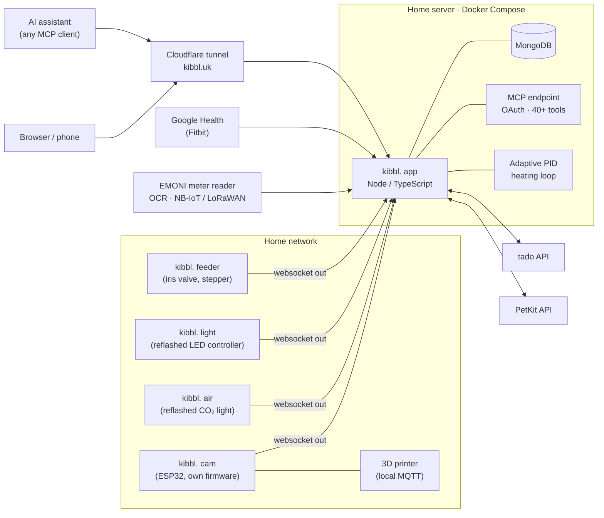

  

<h1 align="center">kibbl.</h1>

  <em>A bridge between hardware, software and AI, for a home that knows about itself, its people and its costs.</em>

  <a href="https://kibbl.uk"><b>kibbl.uk</b></a> · self-hosted on a home server, behind Cloudflare

  
  
  
  
  
  

> This repository is a showcase: what kibbl. does, how it is built and what it looks like. The source code (firmware, server, app and CAD) is in a private repository.

  
  

---

## Why I built it

The appliances in my home were outdated, missing features or not working at all. Each one that did work had its own app and its own cloud, and none of them knew about the others. I wanted **one system that knows about my home, my health and my expenses**, and that lets *me* decide what happens with that data.

So I:

* **reverse engineered, soldered and reflashed** devices that were locked to a vendor (a CO₂ traffic light, a Wi-Fi LED controller behind the TV, cameras) with my own firmware,
* **attached the APIs** of the devices I don't build myself, such as **tado** (heating) and **PetKit** (cat feeder), so they are controlled from the same place,
* **uploaded my landlord's heating statement** (the *Nachzahlung*). kibbl. reads it with OCR and tracks my heat use over the year against what I pay in advance,
* read my **electricity meter**, an old Ferraris meter with a spinning disc, with **EMONI**, a local OCR meter reader over **NB-IoT / LoRaWAN** that I developed,
* connected all of it to an **MCP server**, so an AI assistant can read the home and act on it,
* run an **adaptive PID controller** on top of the thermostats that keeps each room comfortable *and* healthy, without heating more than needed,
* linked **Fitbit / Google Health** data (heart rate, HRV, sleep, SpO₂, sedentary time) with my **gym sessions**, which are logged in the app itself.

The whole app is hosted on my own home server and is **open to other users**: anyone can sign up and connect their own Fitbit, gym training, home devices and AI assistant.

### Your data, your decision

Devices record much more than their apps show you. **Google's Fitbit app, for example, does not show the sedentary data the tracker records.** The API has it, so kibbl. stores the full history on my own server and shows it: minutes worn, active and sedentary through the day, next to heart rate per minute and sleep stages. The goal of the project is to give users control over their own data and over what they do with it.

---

## Sections

Each part has its own folder with the details, screenshots and clips:

| | Section | What it covers |
|---|---|---|
| 🐈 | **[Feeder](feeder/README.md)** | the self-designed iris-valve feeder: parametric CAD, stress analysis, the printed prototype, the **overnight AI-supervised stress test**, PetKit in the meantime |
| 🏋️ | **[Gym](gym/README.md)** | every kind of training, double progression and stall detection, volume per muscle on an anatomy chart, 270 exercises, Strong import |
| ❤️ | **[Health](health/README.md)** | the full Fitbit history on my own server, including the **sedentary data Google's app hides**, heart rate per second, sleep stages |
| 🔥 | **[Heating](heating/README.md)** | tado with an **adaptive PID loop**: room model learned by recursive least squares, IMC tuning, anti-windup, API budget |
| ⚡ | **[Energy](energy/README.md)** | the Ferraris meter read by **EMONI** (OCR, NB-IoT / LoRaWAN), radiators and the landlord's statement read by OCR, the *Nachzahlung* known in advance |
| 🌬️ | **[Air](air/README.md)** | a reflashed CO₂ traffic light: open windows, cigarettes, fire warning, mould risk |
| 💡 | **[Light](light/README.md)** | a reflashed 1 MB LED controller behind the TV: TLS and OTA in 490 KB, moods, sunrise, an Android TV app |
| 📷 | **[Camera](camera/README.md)** | own camera firmware, activity without pictures by default, setup over USB or by phone |
| 🤖 | **[MCP](mcp/README.md)** | the AI end: 44 tools to read the whole home and act on it, mood and nervous-system regulation |

  
  

---

## At a glance

| | |
|---|---|
| **Own hardware** | kibbl. cam, kibbl. air, kibbl. light, kibbl. feeder, all on one protocol, set up over USB from the browser or from a phone |
| **Integrated vendors** | tado (heating), PetKit (feeder), Google Health / Fitbit, Bambu Lab printer over local MQTT, Open-Meteo weather |
| **Meters** | electricity through EMONI's optical OCR reader, heat from radiator allocators and OCR of the yearly statements |
| **Health & training** | the full tracker history, a gym logger for every kind of training, heart rate during each session |
| **AI** | an MCP server with 44 tools: it reads everything and changes what a person can change in the app, every change logged |
| **Control** | adaptive PID heating per room, light moods and timers, night modes, open window → heating off |
| **Hosting** | Docker Compose on a home server, public at kibbl.uk through a Cloudflare tunnel, OTA firmware updates with rollback |

The screenshots and clips come from a demo account with generated data, so none of my personal data is shown. They switch between the app's dark and light modes.

---

## AI and the nervous system

kibbl.'s [MCP server](mcp/README.md) lets any MCP-capable assistant reach **all** of the home's data and act through the same checks as the app.

* **Mood, light and temperature:** tell the assistant how you feel and it sets the light mood and the room temperature to match.
* **Mental health:** log how you are doing in a conversation. The assistant reads it with the body's signals (HRV, resting heart rate, last night's sleep, sedentary time, CO₂ in the room) and decides which settings at home help **calm the nervous system down**: warm, dim light without blue in the evening, a comfortable temperature, fresh air, a reminder to move.
* **Hardware that tests itself:** the feeder's iris ran an [overnight stress test](feeder/README.md#stress-test-overnight-with-the-ai-watching) with an assistant watching it through a camera, deciding how far to open and close, with no supervision.

---

## Architecture

* **Firmware** in C on ESP-IDF, one shared core (server link, commands, Wi-Fi setup portal, OTA with rollback, NVS) and one project per product. The LED controller is an ESP8285 with 1 MB flash, so it is an Arduino sketch that speaks the same protocol and fits two images for OTA.
* **Devices only connect outwards** over one websocket, so nothing at home needs a port forward. Setup works over USB from the browser (Web Serial) or from a phone through the device's own setup Wi-Fi and a pairing code.
* **Server:** Node / TypeScript (Express, socket.io, ws), MongoDB, one process. Vendor tokens are encrypted at rest (AES-256-GCM).
* **App:** a multi-page Vite app in its own autumn, halftone "entering a game" theme, with day and night modes. The gym part is an installable PWA.
* **Hosting:** Docker Compose on my home server, published at **kibbl.uk** through a Cloudflare named tunnel. One-command deploys.

---

## Status

kibbl. runs every day in my home. Next up: the feeder on its own EMONI-based board (camera, illuminator and motor driver on one PCB), telling pets from people on the camera, and the parts for heating control.

---

© Huzaifa Ejaz. Images and videos in this repository may not be reused without permission.

