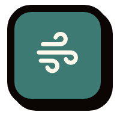
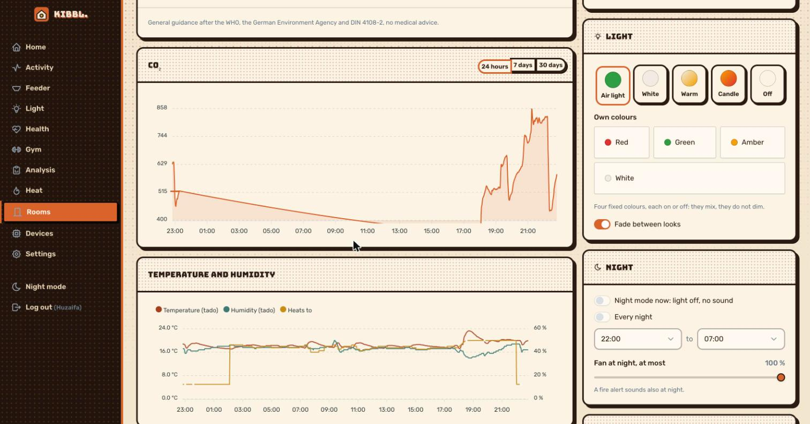
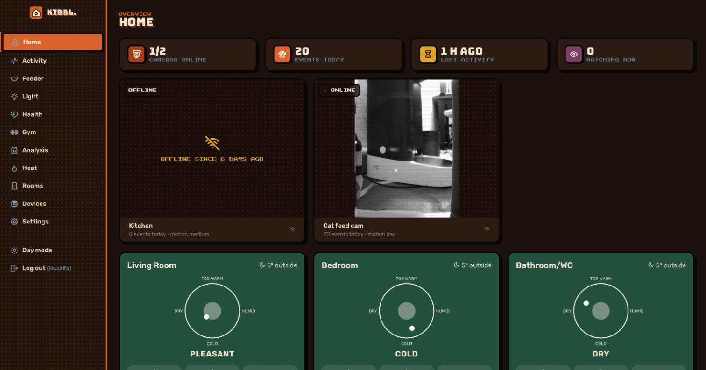
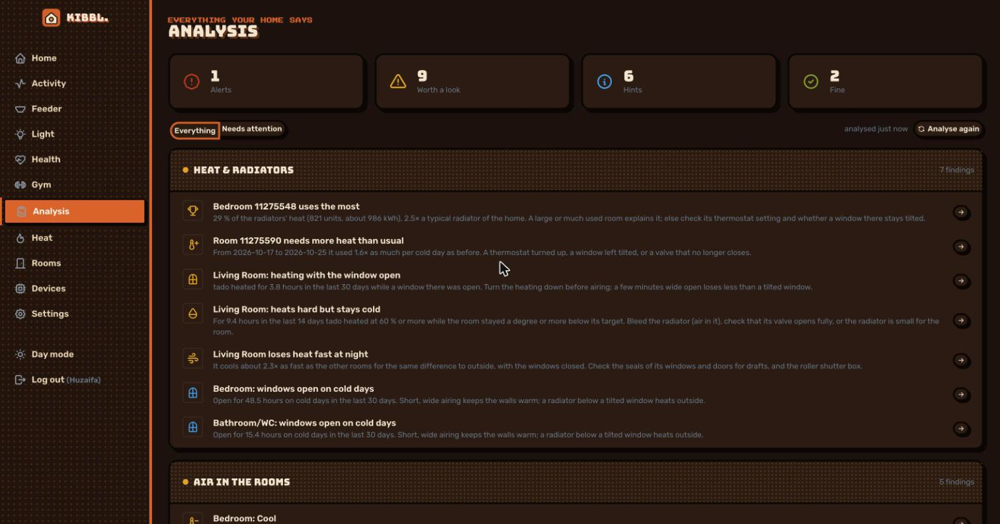

[← kibbl.](../README.md)

#  kibbl. air: a reflashed CO₂ traffic light

An existing CO₂ traffic light board with **firmware I rewrote from scratch**. The original firmware was backed up first. Everything below runs on the device without the network, and events wait for the server.

  

## The hardware

- **ESP32-C3** with a Sensirion **SCD30** CO₂ sensor and an I/O expander on one I²C bus (the expander's chip is detected at boot, since two variants exist).
- Red, green, amber and white LEDs on constant-current drivers, a fan (25 kHz PWM), a buzzer and a button.
- An **external watchdog** fed by the firmware first thing at boot, before anything else runs.
- Flashed through a Tag-Connect programming adapter.

## What the firmware does

| Feature | How |
|---|---|
| **Traffic light** | SCD30 every 2 s, the mean of 3 readings, 50 ppm hysteresis, so the light doesn't flicker between colours |
| **Temperature** | corrected for the board's own warmth (4–12 °C depending on LEDs and fan, measured) |
| **Open window** | 30 s means over 3 min: CO₂ falling towards the home's fresh-air level together with the temperature, or steeply on its own. A calibration at the open window records the home's own fresh air. A steep fall is seen within about a minute and plays a short tone |
| **Cigarettes** | exhaled smoke shows as CO₂ **puffs**: a short spike above a slow baseline, back within 90 s; 3 puffs within 4 min make a cigarette. At an open window the puffs are diluted, so the thresholds adapt. The button logs one by hand |
| **Possible fire** | CO₂ and heat rising together, heat rising fast, or 60 °C at the sensor: red flashing and the smoke-alarm tone pattern, also at night. Meant to sit next to a smoke alarm, not to replace one |
| **Fan** | auto by default: 20 % up to 400 ppm below yellow, then rising with the CO₂ to the set level at red, capped at night |
| **Lamp** | traffic light, off, white, warm, candle, own colours; looks fade over 0.6 s by switching fast between the old and the new look |
| **Night mode** | on a schedule: light off, no sound, fan capped |
| **Events queue** | 32 events kept with their age and sent in order once the server is reached |
| **OTA** | firmware updates over the air with rollback; during an update the colours fade round and round |

## In the app

  

- CO₂, temperature (with outside), humidity, cigarettes today, window state.
- **Room climate and health hints:**
  - too cold or too warm (WHO),
  - dry or humid air,
  - **mould risk at outer walls** (estimated from the outside temperature after DIN 4108-2),
  - what airing would do right now (water in g/m³ inside and outside).
- CO₂ and climate over 24 h, 7 or 30 days, cigarettes per day, everything it noticed.
- Light, night schedule, thresholds and buzzer, fan, detection settings and calibration.

  

## Alerts and links

- A health hint that lasts 30 min goes to the owner as a push message (ntfy), the same one at most every 12 h, never in night mode.
- A fire, or a window left open too long in the cold, also by e-mail.
- An open window switches the [heating](../heating/README.md) in that room off.
- The analysis compares its thermometer with tado's in the same room and flags stale air in a bedroom overnight.
- An assistant reads it with `kibbl_air`, `kibbl_air_readings` and `kibbl_air_events`, and changes it with `kibbl_air_set` and `kibbl_air_night_schedule`. See [MCP](../mcp/README.md).
