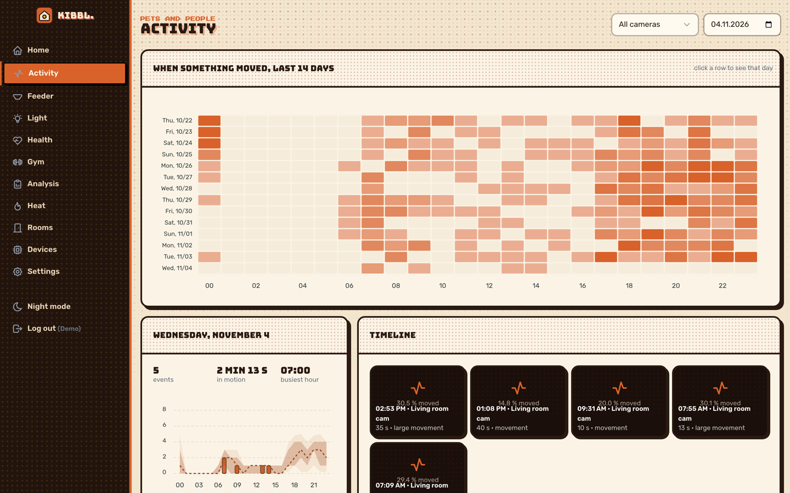
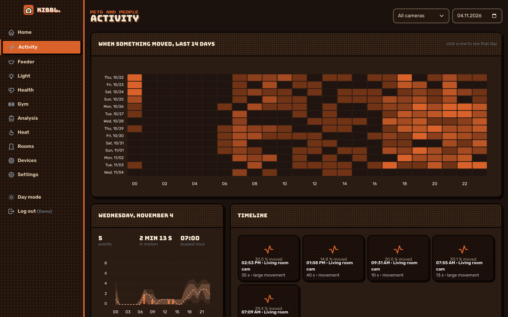
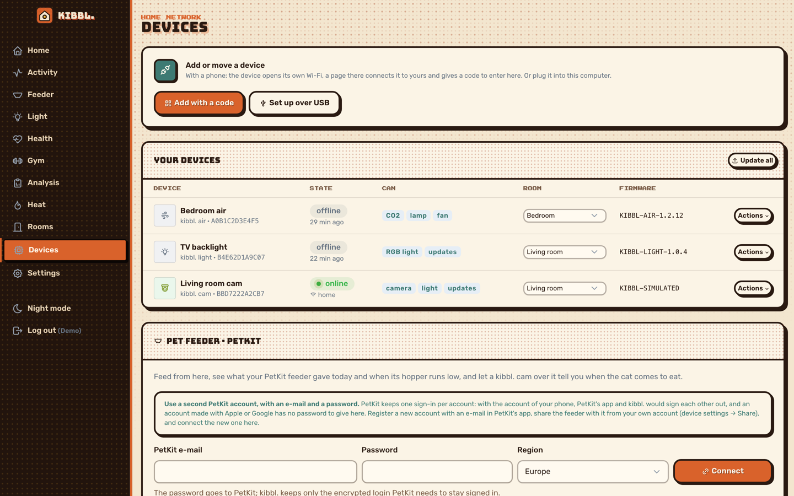
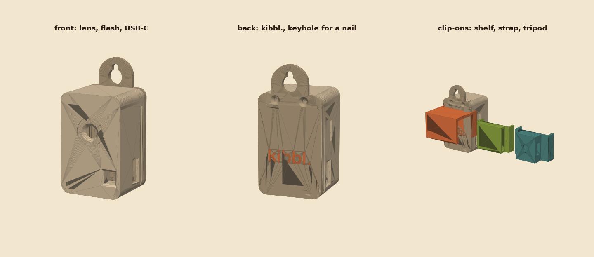

[← kibbl.](../README.md)

#  kibbl. cam: activity, not pictures

An ESP32 camera with **my own firmware**, in a printed case. It streams live video and logs when pets or people move, **without keeping pictures by default**.

  
  

## Firmware

ESP-IDF in C, one task per module, on a shared core that every kibbl. device uses:

- **One outbound websocket** to the server: hello, telemetry, commands, frames at the rate the server asks for. It works behind any home router, with no port forward.
- **One camera task at the highest rate any consumer asks for.** The latest frame is copied out per consumer, so a slow upload never holds a driver buffer.
- A **local stream page** on the home network, protected with a key.
- **Wi-Fi setup without a cable:** with no network, the device opens its own Wi-Fi with a captive setup page. Pick the home network there and get a pairing code to add the device to your account.
- **Or set up over USB from the browser** (Web Serial): plug in, pick the port, choose the Wi-Fi from a scan. A network that doesn't work is undone after 30 s.
- **OTA updates with rollback:** a new image is kept only once it reached the server or ran 5 min.
- Power-cycling three times within 10 s forgets the Wi-Fi.
- The same camera can watch a **3D printer** on the home network over its local MQTT: state, pause, resume, stop, and an alert when a print finishes or fails.

  

## Motion detection on the server

- Every analysed frame is shrunk to 64×48 grey and compared with a **learned background**. Change above the sensitivity in two frames in a row starts an event, and 10 s of calm ends it.
- A light switched on, or a jump in exposure, **resets the background** instead of counting as motion. Brightness changes of the whole picture (auto exposure, clouds) are subtracted first.
- **Privacy first:** only when the camera's "keep pictures" setting is on (off by default) is one picture kept, the frame with the most change. Otherwise an event is activity only: start, end, how much moved.
- **Cat only** (for the feeder): a movement counts only once a cat detector on the server finds a cat in it.
- **Quiet hours** per camera, and a blink of the camera's light on a new event.

## In the app

- Live view (pauses when the tab is hidden), snapshot, full screen, light, picture settings.
- **Activity heatmap** over 14 days (days × hours), day statistics, and events per hour against the other days' median with 25–75 % and 10–90 % bands.
- A timeline of every event.

## The case

  

A parametric printed case with clip-ons and a keyhole hanger, generated by a script like all of kibbl.'s hardware.

## Through the AI

`kibbl_camera_picture` gives an assistant a live picture. `kibbl_motion_events` and `kibbl_motion_activity` give it the activity. This is what made the [overnight feeder test](../feeder/README.md#stress-test-overnight-with-the-ai-watching) possible.
