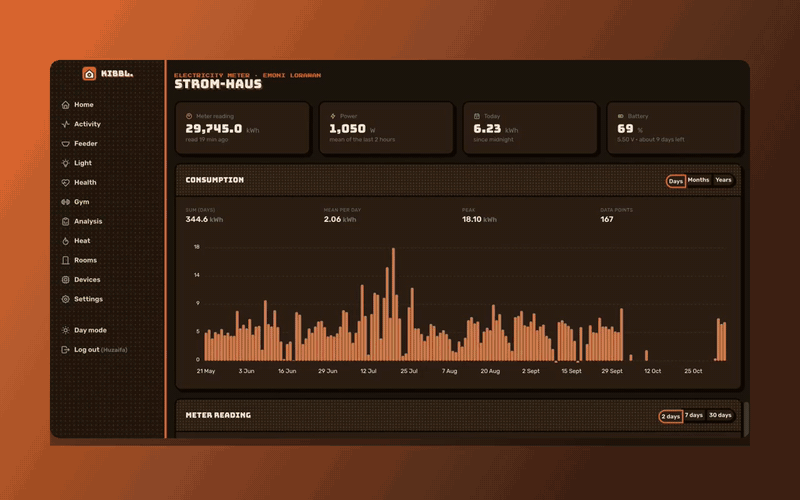
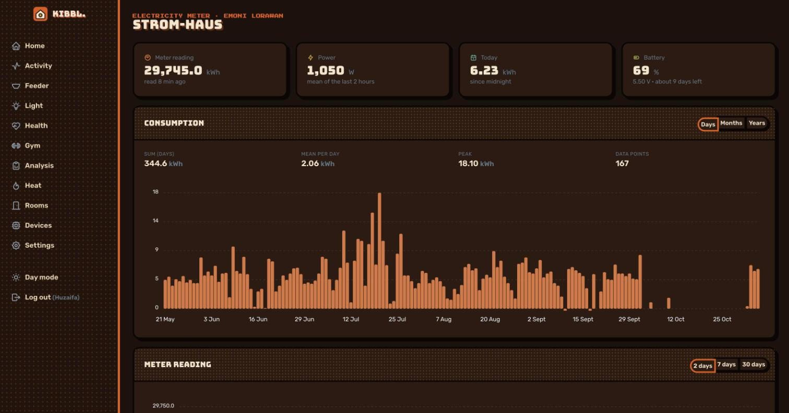
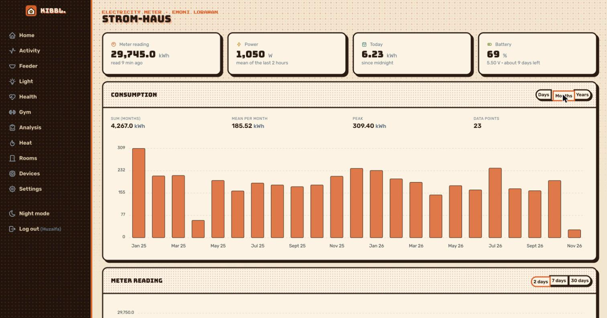
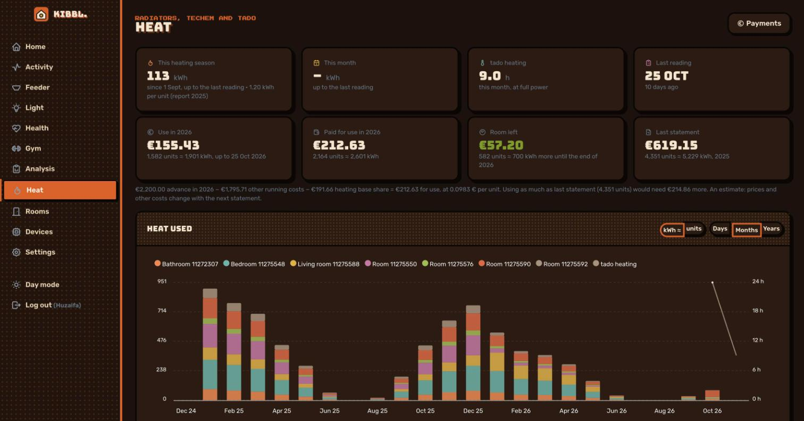
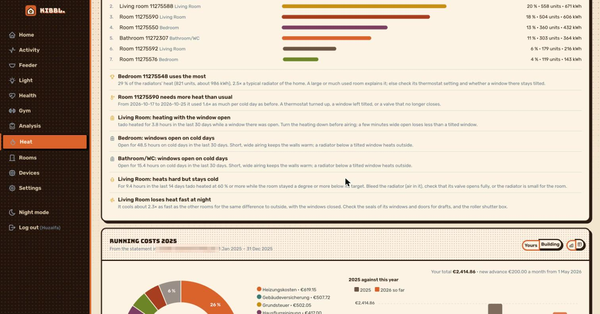

[← kibbl.](../README.md)

#  Energy: electricity and heat

Two meters that were never meant to be smart: an **old Ferraris electricity meter** with a spinning disc, and **heat cost allocators** on the radiators that someone reads once a year. kibbl. turns both into daily data and tells me what the year will cost **before** the bill arrives.

  

## Electricity: EMONI, OCR on the meter

**EMONI** is a battery-powered meter reader I developed. It photographs the meter face, **reads the digits by OCR on the device**, and sends the value over **NB-IoT or LoRaWAN**: no Wi-Fi needed at the meter, on batteries. It runs on its own server (the EMONI LoRaWAN server, which also takes uplinks from TTN and ChirpStack). kibbl. copies everything from it:

- every reading, with the meter value, battery voltage and signal strength,
- consumption per day, month and year, including months before the meter reported (from manual readings),
- live updates: the source announces each new reading on a server-sent-events stream, kibbl. catches up, and the page updates as the reading arrives.

  
  

The meter page shows the reading, power, today's use and battery, consumption by day, month or year (total, mean, peak), and the meter reading over 2, 7 or 30 days.

The **analysis** flags:

- the **base load** from 01:00 to 05:00 (*"325 W run all night: about 2 847 kWh a year. Look for standby devices, an old fridge…"*),
- a day using 1.4× or 0.6× the median day of the last 4 weeks,
- no reading for 6 h, and a battery with less than 60 days left.

## Heat: radiators and the landlord's statement

  
  

- **Readings** of the radiators' heat cost allocators (units × the radiator's factor) and of whole-home meters (kWh, MWh, m³), entered by hand, imported from a report, or added by the AI assistant.
- **Upload the yearly report** (the meter-reading company's *Heizkostenabrechnung*) as a PDF. kibbl. reads it by **OCR**:
  - a heat meter per allocator, found again by its number,
  - the readings before the period and on the reading day,
  - each radiator's factor,
  - the price per unit.
- **Upload the landlord's statement** (*Betriebs-/Nebenkostenabrechnung*) and kibbl. reads its table: each cost with the building's total, how it's shared and the home's share, the advance paid, the **balance (Nachzahlung or Guthaben)**, and from the letter the new monthly advance and when it starts.
- **Heat between two readings is spread over the days** by tado's heating hours in the room, or by **degree days** from Open-Meteo's weather archive at the home's location, or evenly if neither is available. That turns one reading a year into a daily curve.
- **Costs:** the monthly advance against the heat used so far, at the price per unit of the last report, so the next *Nachzahlung* is no surprise.

### Insights: where heat is wasted

- Radiators ranked by their use over the last year.
- A radiator needing 1.4× its usual units per degree day, or counting through warm weeks (a stuck valve).
- tado heating while a kibbl. air in the room saw an **open window**, or windows open for hours on cold days.
- tado at 60 % or more while the room stays 1 °C below the target (the radiator needs bleeding).
- A room that cools 1.5× faster at night than the others, measured by the kibbl. air against the outside temperature.

## Through the AI

`kibbl_meters`, `kibbl_meter_consumption`, `kibbl_meter_readings`, `kibbl_heat` and `kibbl_heat_insights` read it all. `kibbl_heat_readings_add` lets an assistant enter readings (and `kibbl_heat_meter_add` new meters). See [MCP](../mcp/README.md).
