[← kibbl.](../README.md)

# kibbl. feeder

A cat feeder I designed myself: a 1 kg hopper, a **3D-printed iris valve** that portions the food, a chute to the bowl, and a camera that watches the bowl. Until it is finished, kibbl. also runs a **PetKit** feeder through PetKit's cloud.

  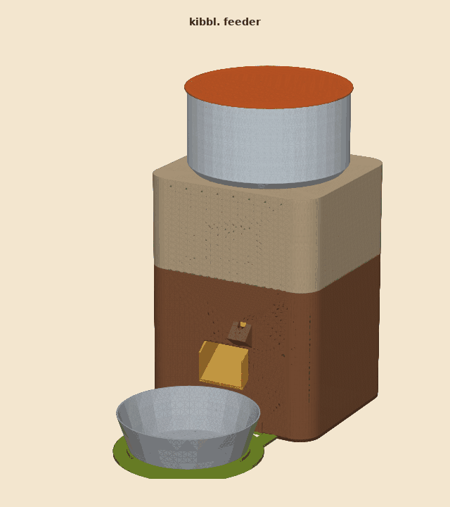
  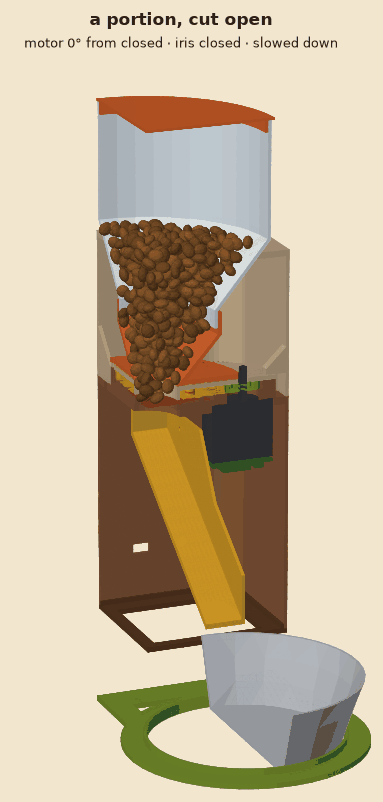

## The iris valve

The food rests on six blades under the hopper. A NEMA 17 stepper turns a ring gear and the blades swing open like a camera aperture. How far and how long the iris opens decides how much falls into the bowl.

  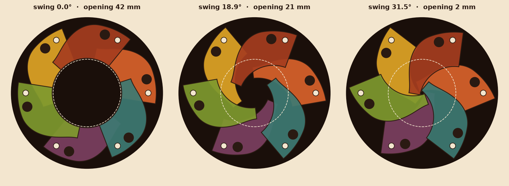

| | |
|---|---|
| Opening | 42 mm open, 2 mm closed (kibble is 8–12 mm) |
| Drive | NEMA 17 → 15-tooth pinion → 75-tooth ring gear (5:1, module 1.5) |
| Stroke | ring 31.5°, motor 157.5°, 1400 microsteps from open to closed |
| Size | Ø 130 mm, 16 mm high without the funnel |
| Blades | 6 × 1.2 mm on **two flat levels** in a 3 mm cavity |
| Motor control | closed-loop driver on the back of the motor, homing against a hard stop |
| Speed | closed in 1.6 s, open in 1.1 s |

### Why two levels

A blade only ever overlaps its two neighbours. Woven like a camera iris, each blade would lie under one neighbour and over the other, and would have to bend 1.2 mm between them. Printed blades can't bend that, so they jam. With six blades, every second one sits one level up, flat, resting on a boss around its pivot and on the lower blades beside it. Seen from above the blades overlap, as any iris must to close. From the side they lie on two levels.

  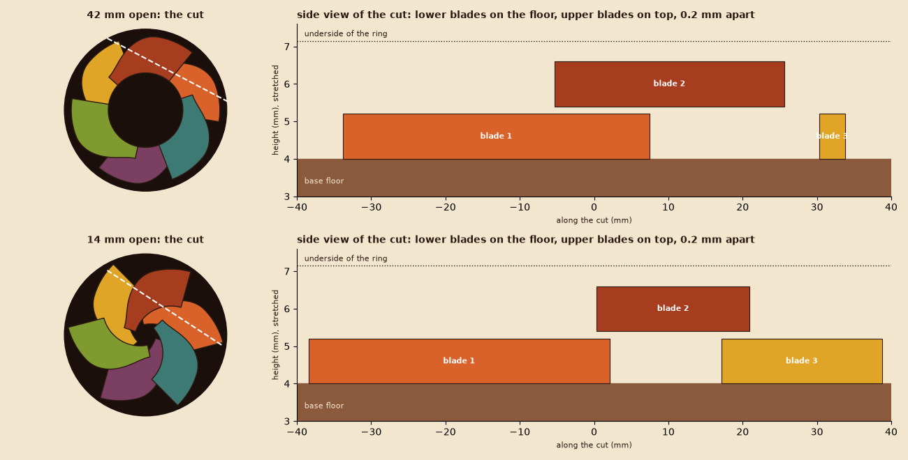

  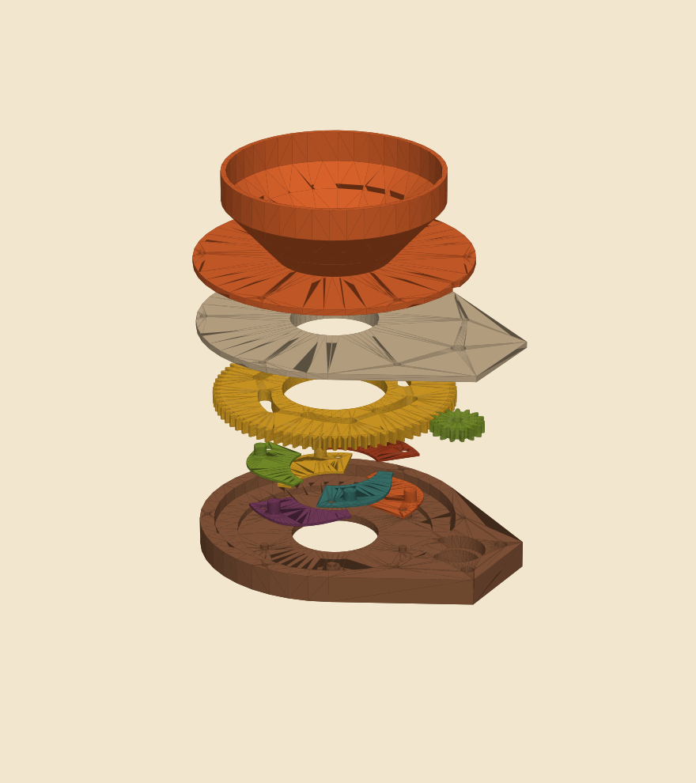
  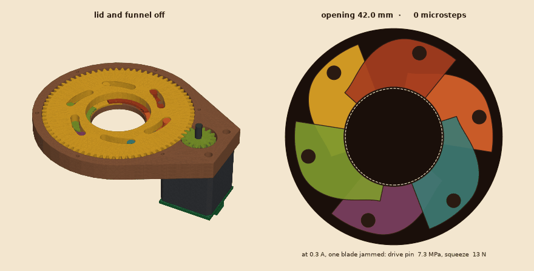

### Designed to survive a jammed kibble

The worst case is a kibble wedged under one blade while the motor pushes. The ring then stops on that blade's drive pin alone, and the linkage multiplies the force: at the motor's rated current that is 250–310 N on one Ø 6 mm printed pin. The design script computes the stress of every weak part over the whole stroke (gear teeth by Lewis, the pins as cantilevers across their print layers) at several driver currents, in PLA and in PETG.

  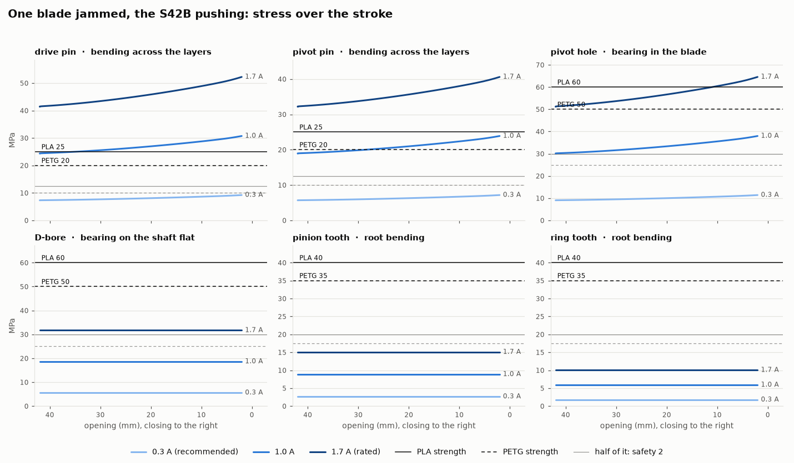

The result: the driver is set to **0.3 A**. That gives a safety factor of 2.7 on the weakest pin with a blade jammed, and still a 13 N squeeze, far more than it takes to push kibble aside. At 1 A a jammed kibble would break a pin. The firmware gives up on a jam, reopens and retries, so no pin stays loaded for hours (PLA creeps under steady load).

### Parametric CAD with a check that refuses bad designs

Every part is a **parametric Python script** (build123d) with its dimensions at the top. STEP files (for Fusion, Onshape, FreeCAD) and STL files (for the slicer) are generated from it. Before it exports anything, a check verifies on the real blade outlines that:

- the open blades stay out of the aperture and the closed stop leaves at most 3 mm,
- never more than two blades overlap, and no blade ever overlaps one on its own level,
- every upper blade rests on both neighbours and no blade covers another's pins,
- the ring slots push the pins at a pressure angle below 55°,
- with one blade jammed, the weakest part keeps a safety factor of 2.

  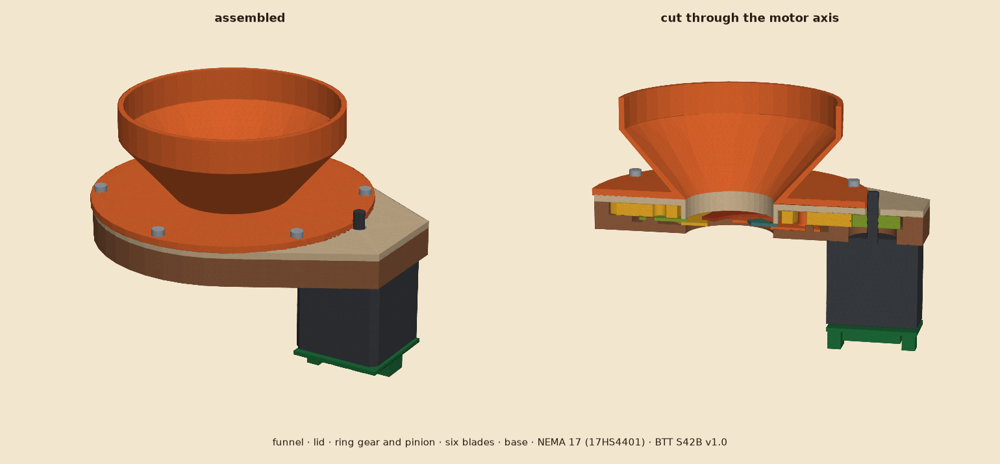

## Printed and on the motor

  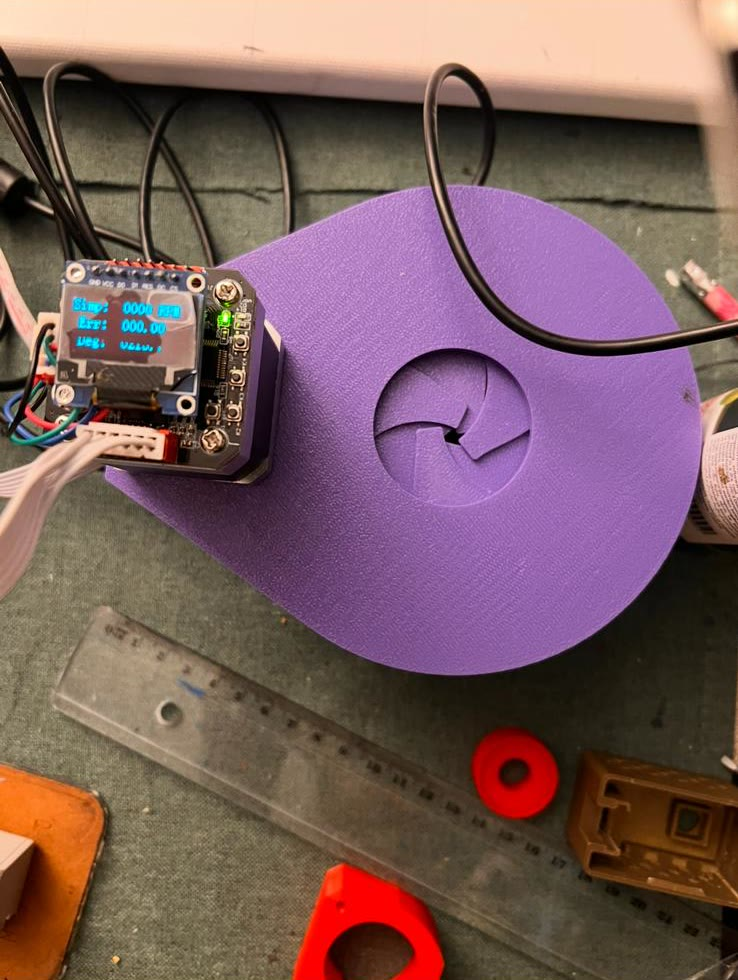
  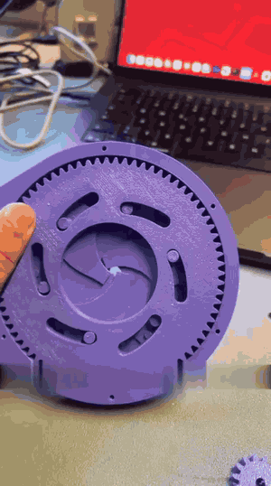

## Stress test: overnight, with the AI watching

To stress-test the iris, I **pointed a kibbl. cam at the opening** and gave the job to an **AI assistant over kibbl.'s [MCP server](../mcp/README.md)**:

1. The assistant opened and closed the iris to different openings.
2. After each move it took a picture of the opening through the camera tools.
3. From the picture it judged whether the iris had reached the position it was told, and decided the next move: how far to open and how far to close.

**The test ran overnight with no supervision.** The plan is to use the same loop of camera, motor and AI later to let the feeder check its own portions: the camera sees whether food actually fell.

  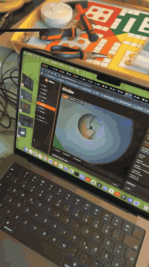

## The whole feeder

| | |
|---|---|
| Size | 200 × 180 mm, 357 mm high with the lid |
| Hopper | 2.5 l above the closed iris: about **1 kg** of dry food, a 50° cone so all of it runs out |
| Chute | 50 mm wide at 35°, ending 10 mm above the bowl rim |
| Bowl | any steel bowl with a rim of about Ø 150 mm, held in place by a tray ring |
| Electronics | an **EMONI main board** (ESP32-S3 with camera) on the inside of the front wall, LEDs and the button showing through; the motor driver under the iris; 12 V in at the back |
| Camera | in an "eye" above the spout, 54° down, 122 mm to the middle of the bowl |
| Filament | about 846 g of PLA, cut to the slicer's standard profile (walls exactly two loops wide, open where nothing stands), a third less than the first design |

  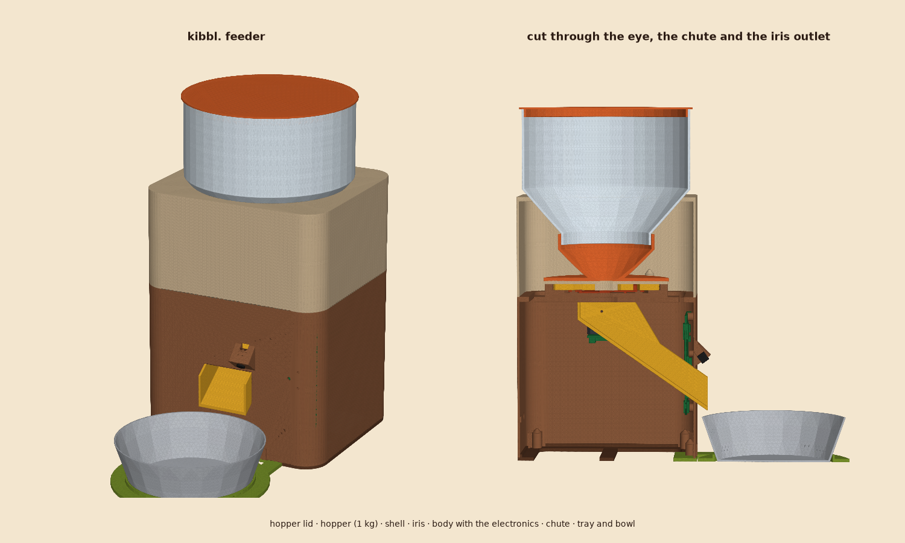
  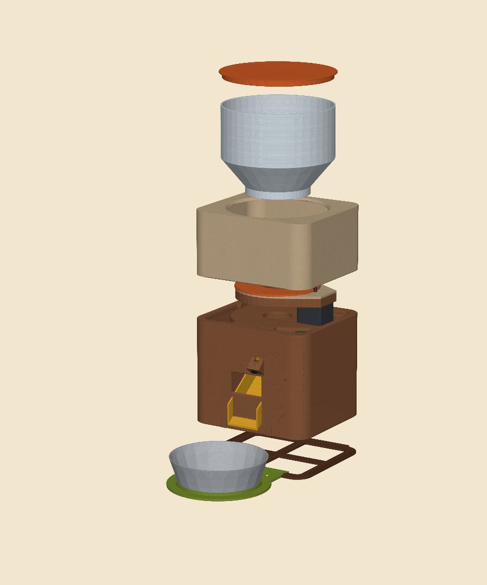

  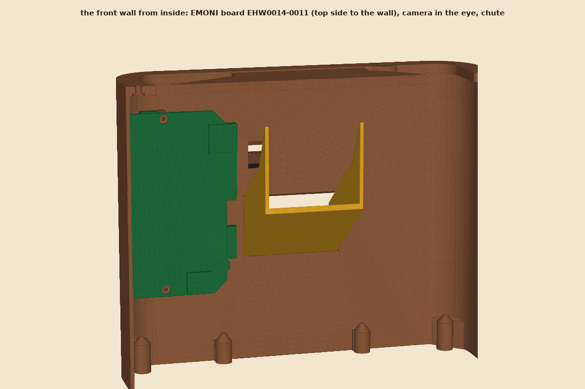
  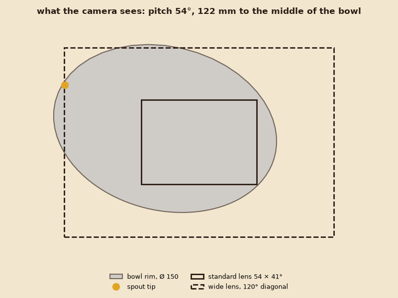

The design check also refuses a feeder that doesn't hold 1 kg, whose spout isn't over the bowl, whose camera cable doesn't reach, whose parts overlap anywhere, or whose parts don't fit the printer's bed.

### One board instead of three

The first prototype used an Arduino Nano for the motor, a USB bridge to the server and a separate camera. The EMONI board replaces all three. Its ESP32-S3 joins the Wi-Fi itself, its camera looks at the iris, its illuminator LEDs light it, and three unused test pads drive the motor driver's STEP, DIR and EN lines. The pads were picked for their resistor dividers: the motor stays off while the board boots, until the firmware knows the position.

## PetKit, in the meantime

The commercial feeder at home (a PetKit Fresh Element Solo) is connected through PetKit's cloud with the same requests as PetKit's own app:

- today's meals and the hopper level, read every minute,
- feed now, skip or restore a meal, pause the plan,
- the **weekly feeding plan** edited in kibbl. and checked as PetKit's app checks it,
- an alert when the hopper runs low, the feeder reports an error, or a meal was not given,
- a kibbl. cam over the feeder: the stream on the feeder page, and with "cat only" motion detection (a cat detector on the server) the activity counts only the cat.

  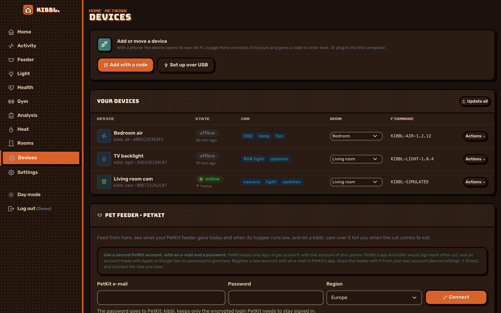

