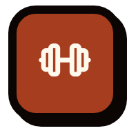
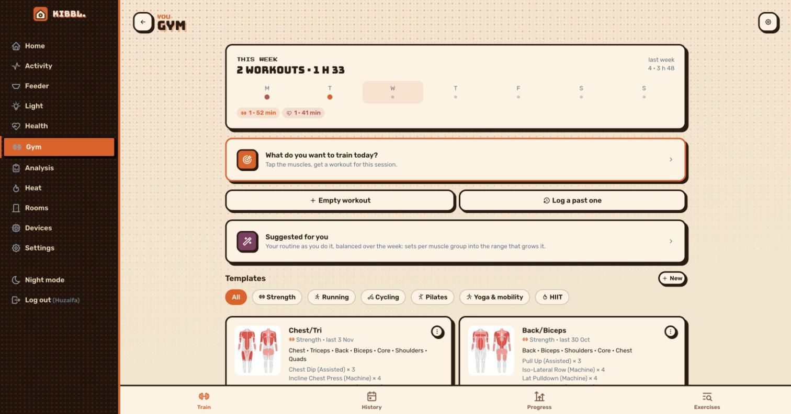
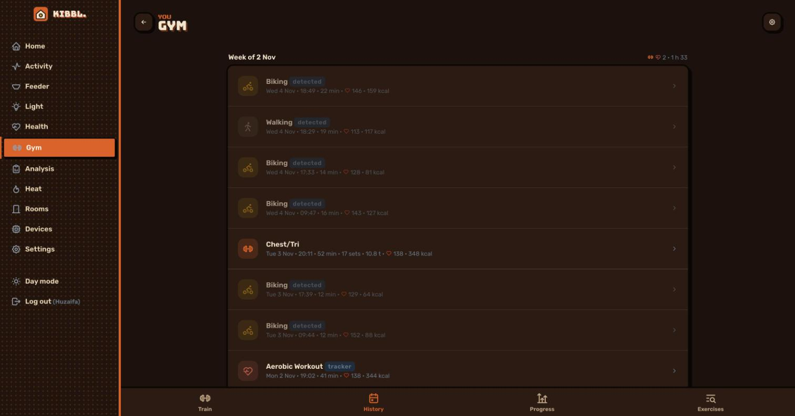
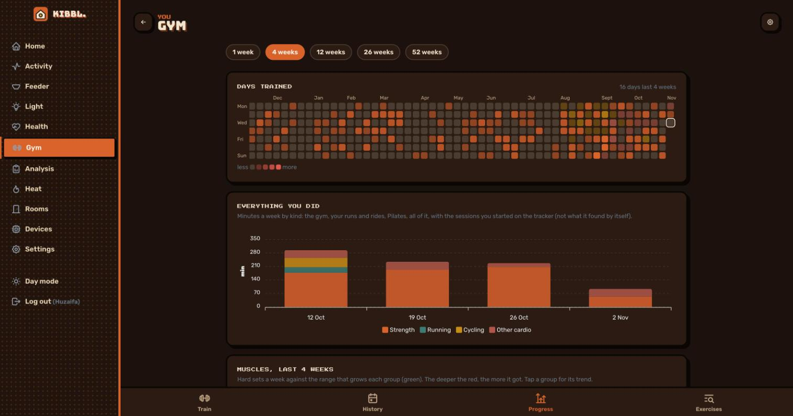
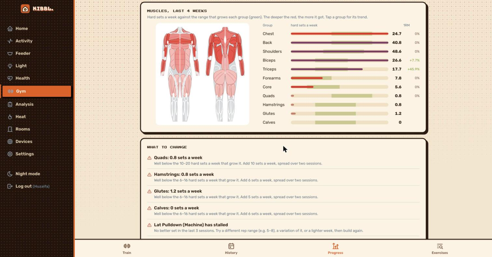
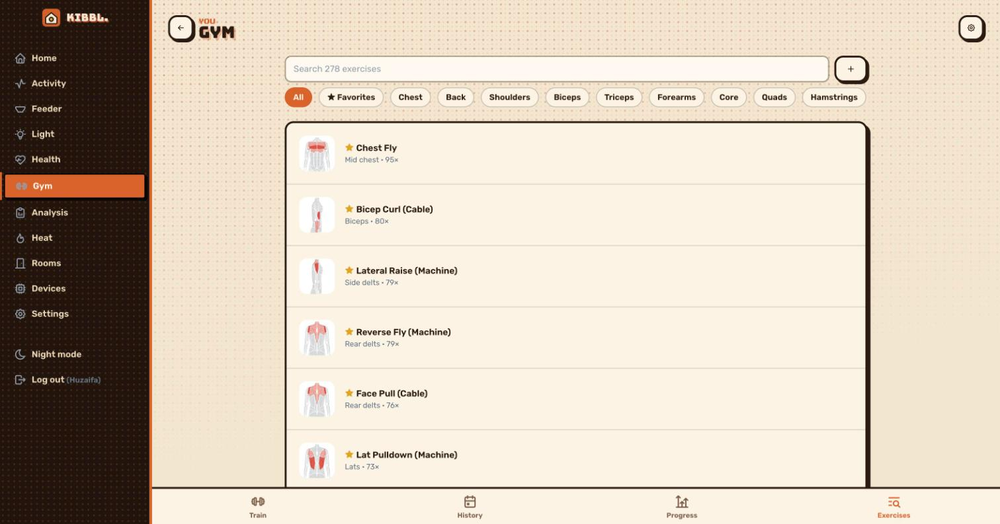

[← kibbl.](../README.md)

#  Gym

Training of **every kind in one place**: lifting, running, cycling, Pilates, yoga and mobility, HIIT, swimming, walking, sport. The week counts everything that was done, not only what one app knows about. It's built for the phone and installs to the home screen (a PWA that works offline in the gym), and it is linked with the fitness tracker, so each session's heart rate sits next to its sets.

  

## Train

  
  

- **This week** by day and by kind, with templates of every kind and the muscles they train.
- **Start a workout** from a template, empty, or log one afterwards.
- The workout runs full screen:
  - each set next to last time's, with the next step suggested,
  - warm-up, drop and failure sets,
  - a rest timer with sound and vibration, the screen kept on,
  - saved a moment after each change and kept in the browser while offline.
- **Build by muscle:** tap the muscles you want to train and get a workout for this session.
- **Import from Strong:** the whole history (Strong's CSV, kg or lbs per exercise) and templates made from your real routine.

## Progression that thinks for you

- **Double progression:** reps go up within the range, then the weight goes up (+2.5 kg, +5 kg for the big lower-body lifts).
- **Stalls are detected:** three sessions at the same weight, none at the top of the range, and the last no better than the first. The app then suggests a 10 % deload. Sets logged at RPE 7 or less aim 2 reps higher and don't count as a stall.
- **Estimated 1RM** (Epley) per exercise, with records, heaviest set and volume over time.

## Progress: volume per muscle

  
  

- **21 muscles in 11 groups.** Each group's hard sets per week are compared with the range that builds it (about 10–20 for the large groups, after Schoenfeld 2017 and Pelland 2024, less for the small ones). A set counts 1 for the muscle trained first and ½ for one that helps.
- **The body as an anatomy chart**, male or female: target muscles in red with their fibres, helpers in light red. Drawings turn like a figure on a turntable (front, side, back) and open full screen with pinch and zoom.
- **Advice:**
  - groups below or far above their range,
  - groups trained on only one day a week,
  - exercises without a better set in their last 3 of 6 weeks,
  - push against pull, hamstrings against quads, rear delts,
  - what improved.
- **Minutes per week by kind**, so a run and a Pilates class count next to the lifting.

## Exercise library

  

A catalog of about **270 exercises**, named as Strong names them, each with primary and secondary muscles, equipment and kind (weight, bodyweight, assisted, hold, mobility, cardio). For an unknown exercise name, the app guesses the muscles from its words.

## Through the AI

Over the [MCP server](../mcp/README.md) an assistant reads workouts, progress and suggestions (`kibbl_gym_workouts`, `kibbl_gym_progress`, `kibbl_gym_suggestions`). It can answer *"what should I train today?"* from the real week, and put the training next to sleep, HRV and resting heart rate from [Health](../health/README.md).
