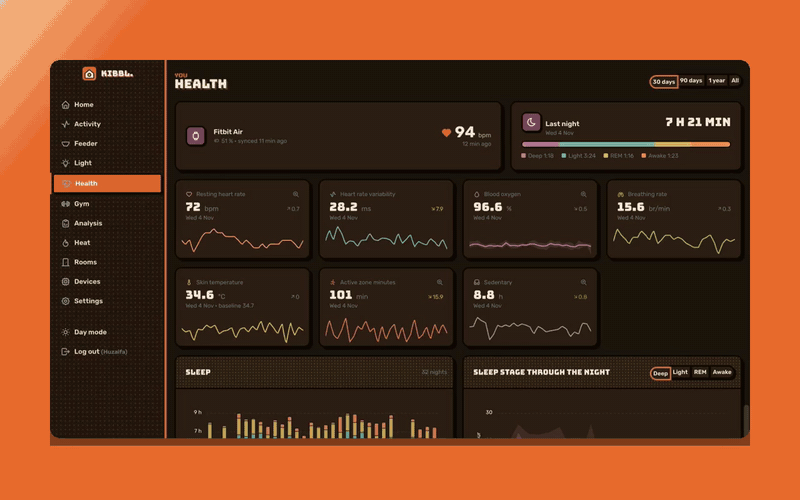
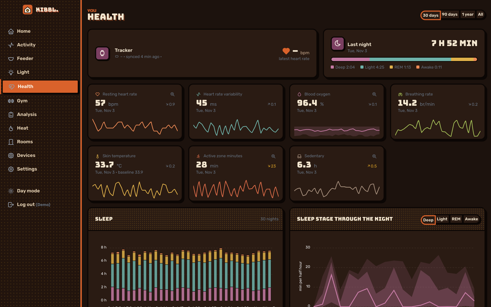
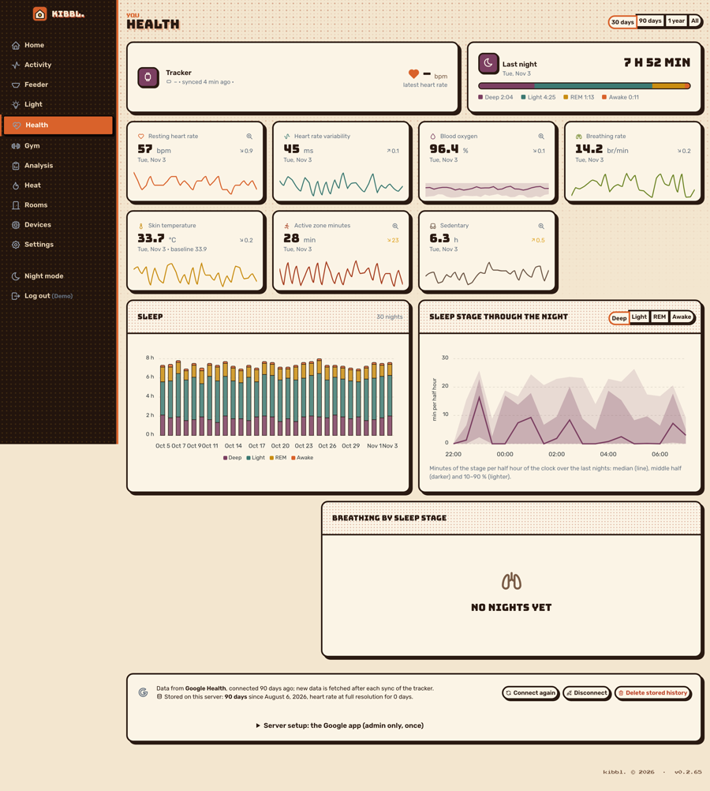

[← kibbl.](../README.md)

#  Health

The data of a fitness tracker (Fitbit) through the **Google Health API**, **stored on my own server**, the full history and not only what the vendor's app chooses to show.

  

## Why

The tracker records much more than its app shows. **Google's Fitbit app doesn't show the sedentary data the tracker records.** The API has it, so kibbl. keeps it and shows it: minutes worn, active and sedentary through the day, next to heart rate per minute and sleep stages. Once the data is on your own server, you decide what happens with it: chart it, compare it with your training, or give it to an AI assistant.

## What's on the page

  
  

- **Tracker:** battery, last sync, latest heart rate.
- **Last night:** total sleep and its stages (deep, light, REM, awake).
- **Metric cards**, each with its trend and 30 days:
  - resting heart rate,
  - heart rate variability (HRV),
  - blood oxygen (SpO₂),
  - breathing rate,
  - skin temperature against its baseline,
  - active zone minutes,
  - **sedentary hours**.
- **Behind each card, one day at full resolution:** heart rate per minute with zones, blood oxygen, zone minutes, and a worn / active / sedentary timeline.
- **Sleep** per night by stage, and the sleep stages through the night as quantile bands over many nights.
- Heart rate zones, breathing by sleep stage, workouts.
- **Newly found data types:** when the API starts returning a type kibbl. doesn't know yet, it's found, fetched back and shown without a code change.

## How the data is kept

- **Sign-in** with OAuth 2.0 + PKCE. Tokens are stored encrypted (AES-256-GCM), never in clear.
- **The whole history is fetched once**, newest first: every data type in 30-day windows going back until 90 days in a row bring nothing, then the heart rate of every complete day at full resolution. The fetch is resumable.
- **After that, only the latest data:** each tracker sync re-reads the last 2 days, because Google revises them and reprocesses sleep.
- **Heart rate at full resolution** (a sample every second or two, about 37 000 a day) is stored as binary per day: about 300 kB a day instead of 13 MB of JSON.
- Data points are stored as Google sent them, by type and day, so the parsers can read them again for any range. Re-fetching a window replaces it and never doubles anything.
- Rate limits (HTTP 429) are respected with back-off.

## With the gym and the home

- **Gym sessions** logged in the app are matched with the tracker's sessions, so a workout shows its heart rate. Sessions only the tracker saw are shown too. See [Gym](../gym/README.md).
- The resting heart rate of 30 days sits on the **home page** next to the meters and cameras.
- Over the [MCP server](../mcp/README.md), an assistant reads health per day and through a day (`kibbl_health_daily`, `kibbl_health_intraday`). Combined with how you say you feel, it can choose the light and temperature at home that help the body calm down.

## Open to other users

Anyone with an account on kibbl.uk can connect their own Fitbit. The data goes into their own account only.
