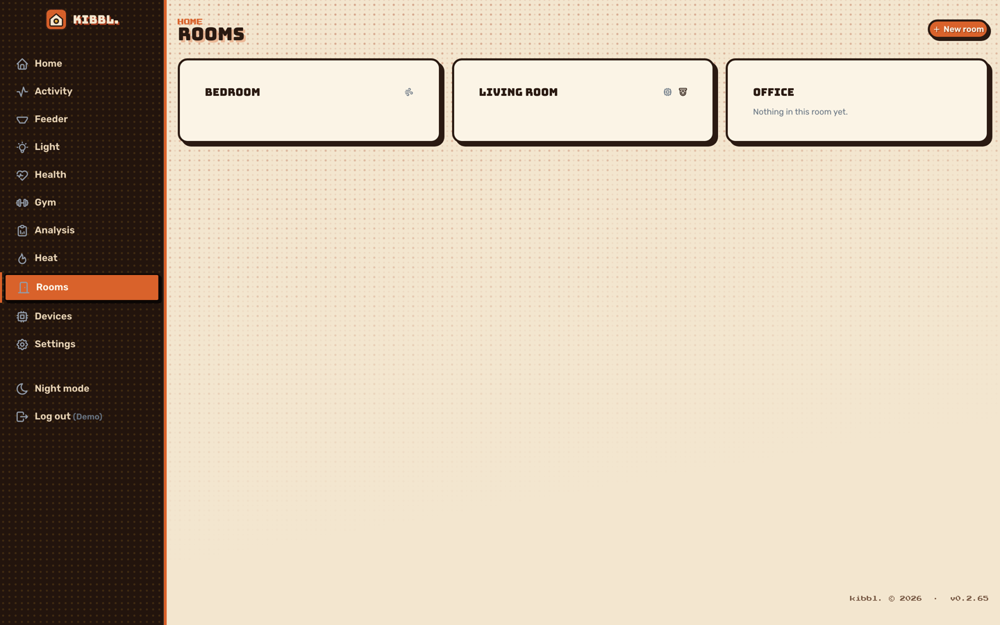
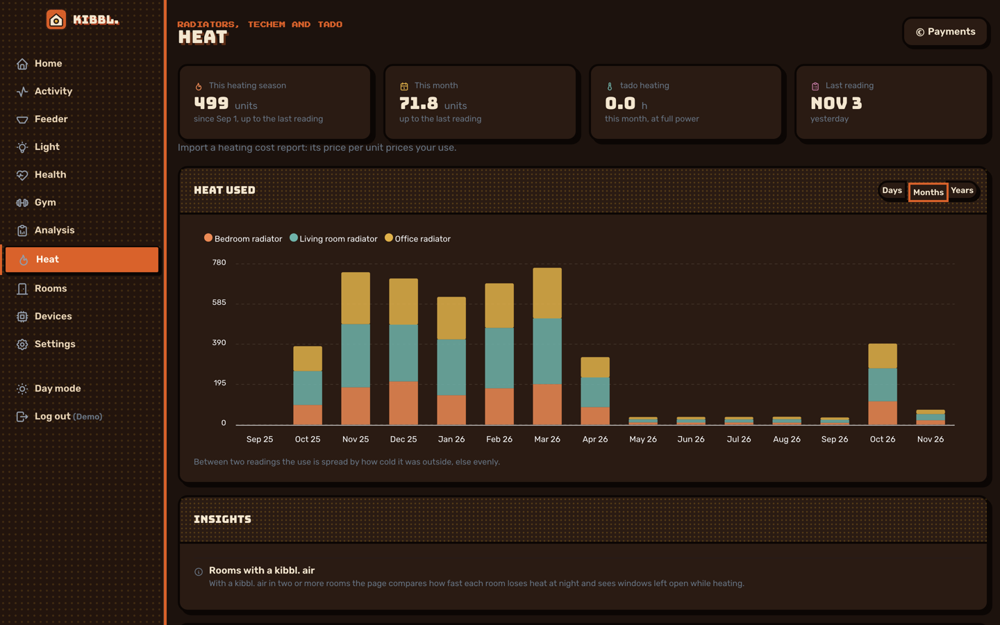
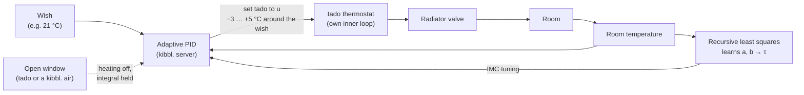

[← kibbl.](../README.md)

# Heating: tado with an adaptive PID loop

The radiators have **tado** smart thermostats. kibbl. connects to tado's API with tado's own device-code sign-in (the password stays at tado, tokens are stored encrypted), reads every room and controls them. On top of tado's own control it runs an **adaptive PID loop** per room.

<p align="center">
  
  
</p>

## The problem

A radiator thermostat measures **next to the radiator**. A cold outer wall, a draft or the sun through the window isn't seen there, so the room ends up colder or warmer than asked. tado regulates its valve to its own sensor and leaves that offset.

## The loop



kibbl. compares the room's temperature with what the person wants, and **sets tado above or below the wish** until the room gets there.

### Adaptive: the room is learned

The room is modelled as a first-order system to the temperature tado is set to:

```
dT/dt = a · (u − T) + b
```

`a = 1/τ` is how fast the room follows, and `b` covers the losses and gains tado doesn't see. Both are **re-estimated after every reading by recursive least squares with forgetting** (about the last 30 readings count), so the model follows the season, the weather and the radiator. A reading teaches nothing when the setting and the measurement are too close, so those are skipped.

### Tuning from the model

The gains come from the learned time constant τ by **IMC tuning**, with a closed-loop settling time λ of 60 min and a dead time θ of 15 min (tado's own loop, the valve, the radiator warming up):

```
Kp = τ / (λ + θ)      Ti = τ      Td = θ / 2
```

A slow room gets a stronger push, a fast one a gentler push. τ is trusted between 20 and 240 min.

### Details that make it work in practice

- **Derivative on the measurement**, filtered, so there's no kick when the wish changes.
- **Anti-windup:** the integral stops while the output is at its limits, and while the heating is off for an open window.
- **tado's 0.5 °C steps with hysteresis**, because a raw output between two steps would flip between them every reading.
- **tado's daily API budget** (100 requests without Auto-Assist) is read from every response's rate-limit header. Readings come every 2–20 minutes depending on what's left, and changes are at least 10 min apart (30 when the budget is low, none near the end).
- **Fail-safe:** every setting lasts 2 h and is renewed, so tado falls back to its own schedule if the server stops.
- The learned state is kept across server restarts.
- Any other command for the room, or a change in tado's own app, ends the adaptive control: the person is always in charge.

## Comfortable and healthy

The target isn't just a number. kibbl.'s room-climate model (WHO 18 °C minimum, humidity 40–60 %, CO₂ after the German Environment Agency, and mould risk at the inner surface of outer walls after DIN 4108-2) tells whether a room is healthy. The goal is a room that is comfortable and healthy **without heating more than needed**.

## Everything else heating does

- **Rooms:** devices and tado's rooms stand in the same rooms. A kibbl. air in a tado room shows tado's temperature and humidity, and its CO₂ stays its own.
- **Open window → heating off:** tado's own detection, or a [kibbl. air](../air/README.md) in the room noticing the CO₂ fall, switches the room off (at most 30 min) and back when the window closes.
- **Weekly schedule** read and changed from the app or by the assistant.
- **Heat used and its cost:** see [Energy](../energy/README.md). tado's heating hours spread the heat meter readings over the days.
- **Through the AI:** `kibbl_heating_set` with mode `adaptive` hands a room to the PID loop. `kibbl_heating_schedule_set` changes the week. See [MCP](../mcp/README.md).
