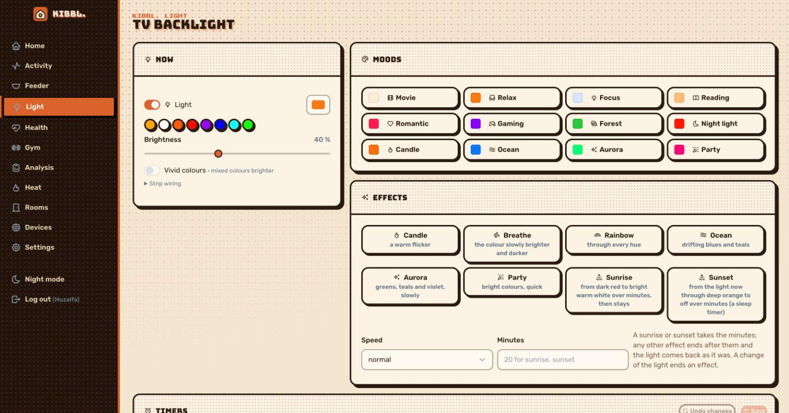

[← kibbl.](../README.md)

#  kibbl. light: the TV backlight

A cheap Wi-Fi LED controller behind the TV, **opened up and reflashed** with my own firmware, so it speaks kibbl.'s protocol instead of its vendor's cloud.

  

## Fitting a TLS client into 1 MB

The controller is an **ESP8285 with 1 MB of flash** and three low-side MOSFETs, one per colour. Updates over the air need two firmware images to fit in flash, the running one and the new one:

- ESP-IDF 5 doesn't support the ESP8266 family.
- The ESP8266 RTOS SDK with TLS produced images of about 615 KB, so two don't fit.
- So this device is an **Arduino sketch** with its own counterparts of kibbl.'s firmware modules: the same protocol, commands, pairing code and setup page. The image is about **490 KB**, so two fit and OTA works.
- TLS with **BearSSL**, the root certificates of the CAs in use compiled in, and the time from NTP to check their validity.

## Light that looks right

- **Fades as the eye sees them:** gamma 2.2, 1 kHz PWM, 1000 steps.
- **Moods:** movie (a dim neutral bias light behind the screen), relax, focus, reading, romantic, gaming, forest, **night light** (a faint red without blue, for late evenings), candle, ocean, aurora, party.
- **Effects** played by the server: candle flicker, breathe, rainbow, ocean, aurora, party, and **sunrise and sunset** over a set number of minutes.
- **Weekly timers**, e.g. a 20-minute sunrise at 07:00 on weekdays, or the night light at 22:30.
- **Alert flashes:** a short signal for events at home.
- The last colour is restored after a power cut.

## On the TV itself

A small **Android TV app** (plain Java, no libraries, about 40 KB) controls the light with the TV remote: on and off, brighter and dimmer, moods and effects. It uses a token that opens **only the light** and nothing else.

## Through the AI

`kibbl_light_mood`, `kibbl_light_effect`, `kibbl_light_flash`, `kibbl_light_timer_set` and `kibbl_light_alerts_set`. This is how the assistant sets the light to match a mood, or to calm the evening down (warm, dim, no blue). See [MCP](../mcp/README.md).
