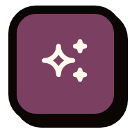
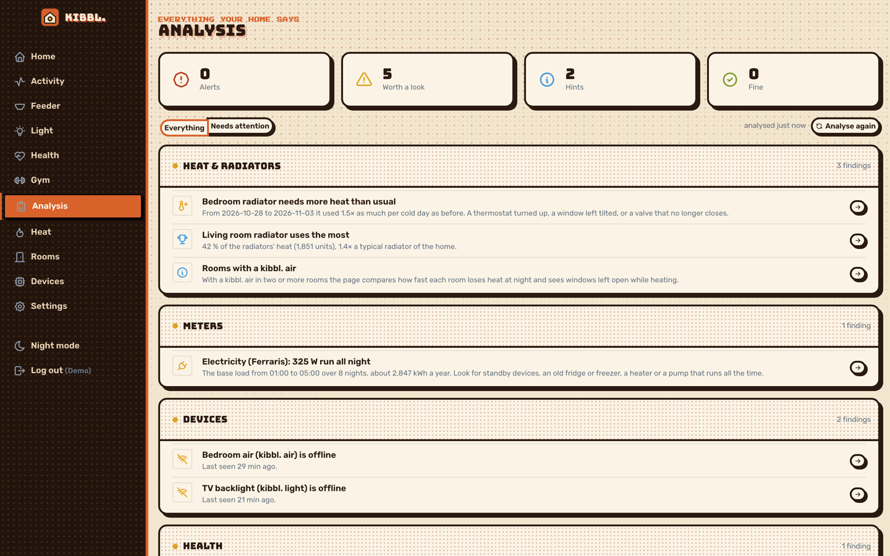
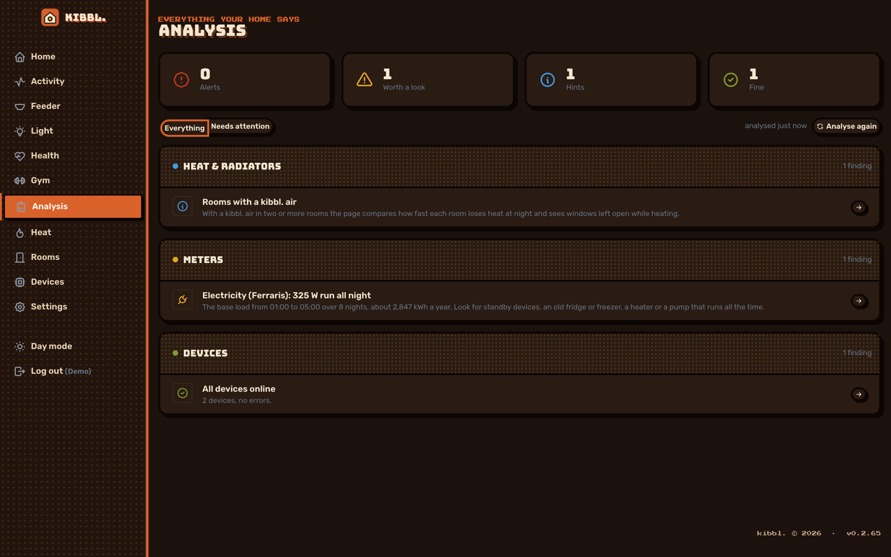

[← kibbl.](../README.md)

#  kibbl. MCP server

kibbl. serves an [MCP](https://modelcontextprotocol.io) endpoint at `/mcp` (Streamable HTTP, stateless). An AI assistant signs in with **OAuth** (dynamic client registration and a kibbl. sign-in page) or with a **personal access token**. Only token hashes are stored, and a token can be revoked at any time.

Each person reaches only their own home: their devices, meters, rooms, health and training. Write tools go through the same checks as the app, and every change is logged with `via=assistant`.

## What it is for

kibbl. is a bridge between hardware, software and AI. The MCP server is the AI end: one connection gives an assistant the whole home (cameras, air, heating, light, feeder, meters, heat costs, health and training) to read and act on, with the person deciding what it may change.

- **Mood, light and temperature:** say how you feel and the assistant sets the light mood and the room temperature to match.
- **Mental health and the nervous system:** log how you're doing in a conversation. The assistant reads it next to the body's signals (HRV, resting heart rate, sleep, sedentary time) and the room (CO₂, temperature), and decides which settings at home help calm the nervous system down.
- **Unsupervised hardware tests:** the [feeder's iris](../feeder/README.md#stress-test-overnight-with-the-ai-watching) was stress-tested overnight by an assistant watching it through a camera.
- **Questions across everything:** *"Why was my electricity higher last week?"*, *"Is the bedroom air stale at night?"*, *"How did my resting heart rate change since I started training three times a week?"*

The analysis page, which `kibbl_analysis` also returns, collects whatever stands out across the home:

  
  

## Read tools

| Tool | What it returns |
|---|---|
| `kibbl_overview` | the home at a glance: devices, rooms and their latest values |
| `kibbl_devices` | every device with status, firmware, signal and capabilities |
| `kibbl_camera_picture` | a live picture from a camera |
| `kibbl_motion_events` | motion events in a range |
| `kibbl_motion_activity` | activity per hour and day |
| `kibbl_motion_picture` | the picture kept for an event (if the camera keeps pictures) |
| `kibbl_air` | a kibbl. air now: CO₂, temperature, humidity, window, advice |
| `kibbl_air_readings` | CO₂ and climate over time |
| `kibbl_air_events` | cigarettes, open windows, fire warnings |
| `kibbl_heating` | every tado room: temperature, humidity, setpoint, heating power, PID state |
| `kibbl_heating_schedule` | the weekly heating schedule |
| `kibbl_meters` | meters with reading, battery and signal |
| `kibbl_meter_consumption` | consumption per hour, day, month or year |
| `kibbl_meter_readings` | raw readings |
| `kibbl_heat` | heat used per meter and room, with costs against the advance paid |
| `kibbl_heat_insights` | what stands out in the heat use |
| `kibbl_analysis` | everything that stands out across the home |
| `kibbl_health_status` | tracker, battery, last sync |
| `kibbl_health_daily` | resting heart rate, HRV, SpO₂, breathing, skin temperature, sleep, zone minutes, sedentary, per day |
| `kibbl_health_intraday` | one day at full resolution: heart rate per minute, sleep stages, worn / active / sedentary |
| `kibbl_gym_workouts` | workouts of every kind with sets, plus the tracker's sessions |
| `kibbl_gym_progress` | volume per muscle, records, days trained |
| `kibbl_gym_suggestions` | templates suggested for the week's balance |
| `kibbl_light` / `kibbl_light_plan` | the lights now, their timers and alerts |
| `kibbl_feeder` / `kibbl_feeder_today` | the feeder, food level, today's meals |

## Write tools

| Tool | What it changes |
|---|---|
| `kibbl_heating_set` | a room: temperature, off, back to schedule, or **adaptive** (held by the PID loop) |
| `kibbl_heating_schedule_set` | the weekly heating schedule |
| `kibbl_light_set` | colour and brightness |
| `kibbl_light_mood` | a mood: movie, relax, focus, reading, night light (no blue), candle, ocean… |
| `kibbl_light_effect` | sunrise, sunset, candle, breathe, rainbow, aurora… |
| `kibbl_light_flash` | a short flash as a signal |
| `kibbl_light_timer_set` / `kibbl_light_alerts_set` | weekly timers, alert flashes |
| `kibbl_air_set` / `kibbl_air_night_schedule` | a kibbl. air: lamp, fan, thresholds, beeps, night mode |
| `kibbl_camera_set` | camera light, picture, motion detection |
| `kibbl_feeder_feed` / `kibbl_feeder_schedule` | feed now, the weekly feeding plan |
| `kibbl_rooms_edit` | make and rename rooms, move devices |
| `kibbl_home_location_set` | the home's location, for the weather outside |
| `kibbl_heat_meter_add` / `kibbl_heat_readings_add` | heat meters and their readings |

**Not available to an assistant, on purpose:** calibration, firmware updates, Wi-Fi changes, restarts, removing devices, factory resets, deleting events or pictures.

## Example: calming the home down

> *"Rough day, my head is buzzing."*

The assistant reads today's HRV and resting heart rate, last night's sleep, the time spent sitting and the CO₂ in the room. Then it acts, for example:

1. `kibbl_light_mood` → **relax** (warm, 40 %) now, **night light** after 22:00 (no blue)
2. `kibbl_heating_set` → the living room **adaptive** at a comfortable 21 °C
3. `kibbl_air` shows CO₂ at 1 400 ppm → it suggests opening a window. The heating switches off by itself while the window is open.
4. It suggests a short walk, because sedentary time is high today.

How the person felt is kept in the conversation, next to the data, so the next answer can build on it.
